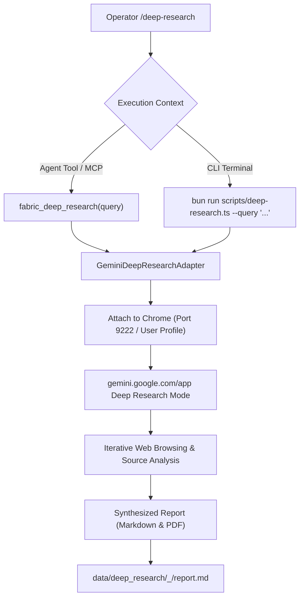

# Gemini Deep Research Skill

Use this skill whenever the operator asks for in-depth, comprehensive research on a complex question, architecture comparison, literature review, or market analysis that benefits from reading dozens of web sources.

## 🚀 How It Works
Instead of incurring pay-as-you-go API charges via the Google GenAI SDK, this skill leverages the operator's **existing Google AI Pro / Advanced consumer subscription** through local browser automation (Puppeteer & Chrome DevTools Protocol).



---

## 🛠️ MCP Tool Usage (`fabric_deep_research`)

When invoking from an AI agent:

```json
{
  "name": "fabric_deep_research",
  "arguments": {
    "query": "Comprehensive analysis of local AI coding agents: Claude Code vs Gemini CLI vs Aider",
    "exportToDocs": true,
    "downloadPdf": true,
    "async": false
  }
}
```

### Parameters:
- `query` *(string, required)*: Research topic, thesis, or question.
- `exportToDocs` *(boolean, optional)*: Automatically export the report to Google Docs.
- `downloadPdf` *(boolean, optional)*: Download the Google Doc directly as a formatted PDF.
- `async` *(boolean, optional)*: Return immediately with a `taskId` for long-running execution.

---

## 💻 CLI Commands & Quick Reference

```bash
# 1. Check if the browser session is authenticated
bun run scripts/deep-research.ts --check-auth

# 2. If unauthenticated, launch Chrome once to log in
./scripts/launch-research-browser.sh

# 3. Run a deep research task and save markdown report
bun run scripts/deep-research.ts --query "Compare Paxos vs Raft vs Zab distributed consensus"

# 4. Run deep research with Google Docs export and local PDF download
bun run scripts/deep-research.ts --query "CRISPR off-target prediction deep learning models" --export-docs --pdf
```

---

## 📂 Output Artifacts
All research runs persist reports locally under:
- `data/deep_research/<timestamp>_<query-slug>/report.md`: Clean, full markdown report with source citations and tables.
- `data/deep_research/<timestamp>_<query-slug>/report.pdf`: Downloaded PDF (when `--pdf` is enabled).
- Ingested automatically into Fabric's Knowledge Graph when running through Fabric OS.

