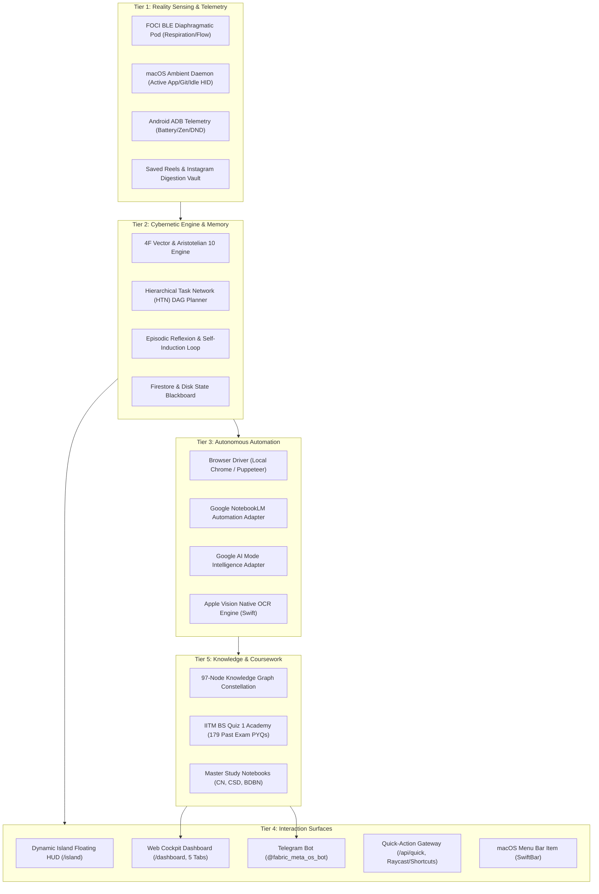

# Fabric OS — Agent Handoff & Architecture Dossier

> **For AI Coding Agents & Autonomous Subagents**  
> *Last Updated: November 4, 2026*  
> *Test Status: 316 pass, 0 fail (26 test files, 4,733 assertions)*  
> *Git Branch: `main`*  
> *Production Deployment: https://fabric-one-sage.vercel.app*

---

## 🌟 1. Executive Summary & North Star

**Fabric OS** is an autonomous, Aristotelian human-agent symbiotic operating system designed to eliminate digital cognitive friction, optimize personal bio-vitality, and compound multi-domain intelligence. It bridges high-agency philosophical frameworks (**Aristotle's 10 Golden Means** and the **4F Vector: Focus, Facts, Funds, Feedback**) with real-time reality sensing, wearable telemetry, background automation, and force-directed knowledge graph synthesis.

---

## 🏛️ 2. Core Mathematical & Architectural Foundations

### The 4F State Continuum
At any time $t$, the operator's cognitive and existential state is modeled as a 4-dimensional vector:

$$\mathbf{S}(t) = \begin{bmatrix} F_{\text{focus}}(t) \\ F_{\text{facts}}(t) \\ F_{\text{funds}}(t) \\ F_{\text{feedback}}(t) \end{bmatrix} \in [-5, +5]^4$$

Where each dimension tracks the Aristotelian Golden Mean between excess and deficiency:
1. **Focus ($F_{\text{focus}}$)**: Deficient = Distracted/Fragmented ($-5$), Optimal = Deep Flow ($0$), Excessive = Tunnel Vision/Cognitive Burnout ($+5$).
2. **Facts ($F_{\text{facts}}$)**: Deficient = Ignorance/Stagnation ($-5$), Optimal = Grounded Knowledge ($0$), Excessive = Intellectual Gluttony/Overthinking ($+5$).
3. **Funds ($F_{\text{funds}}$)**: Deficient = Depleted Vitality/Scarcity ($-5$), Optimal = Asymmetric Leverage/High Vitality ($0$), Excessive = Sedentary Hoarding/Over-leverage ($+5$).
4. **Feedback ($F_{\text{feedback}}$)**: Deficient = Blind Isolation ($-5$), Optimal = Calibrated Self-Correction ($0$), Excessive = Social Noise/Neurotic Echo-Chambers ($+5$).

### The Cybernetic Loss Function
The system acts as a cybernetic feedback governor minimizing existential dispersion:

$$\mathcal{L}(\mathbf{S}) = \sum_{i \in \{1..4\}} w_i \cdot \left( S_i - S_i^* \right)^2 + \lambda \sum_{j=1}^{10} \Phi_j(A_j)$$

Where $S_i^*$ is the optimal target, $A_j$ are the 10 Aristotelian Virtue dimensions, and $\Phi_j$ penalizes extreme vice.

---

## 🗺️ 3. Full System Architecture (5 Tiers)



---

## 📂 4. Repository & File Structure Map

```
/Users/holyscript/Desktop/projects/fabric/
├── api/                                # Vercel Serverless Function Handlers
│   ├── dashboard.ts                    # Master Cockpit HUD (5 Tabs, KaTeX, Graph, HTN DAG)
│   ├── island.ts                       # Dynamic Island OLED HUD (SSE telemetry, FOCI wave)
│   ├── quick.ts                        # Ultra-low latency smart surface dispatcher (/api/quick)
│   ├── docs.ts                         # Live architecture & explainability reader (/docs)
│   ├── a2a.ts                          # Agent-to-Agent communication endpoint
│   └── webhooks/                       # Telegram & external ingress
├── src/
│   ├── ai/
│   │   ├── reflexion.ts                # Episodic Reflexion, Axiom Induction & Heuristic Linker
│   │   ├── sentinel.ts                 # Cognitive Sentinel periodic health auditor
│   │   └── council.ts                  # Socratic Polymath Council synthesis
│   ├── tasks/                          # Hierarchical Task Network (HTN) Engine
│   │   ├── types.ts                    # HTN TaskPlan, Step, Dependency DAG, State types
│   │   ├── planner.ts                  # Goal compiler with Kahn's cycle-detection DAG algorithm
│   │   ├── executor.ts                 # Parallel wavefront executor & token resolution (${blackboard})
│   │   └── store.ts                    # Dual Local File & Firestore persistence
│   ├── browser/                        # Headless Browser Automation Subsystem
│   │   ├── driver.ts                   # Puppeteer-core connected to macOS Chrome profile
│   │   ├── adapters/
│   │   │   ├── notebooklm.ts           # Automated NotebookLM notebook creator & podcast trigger
│   │   │   └── aimode.ts               # Google AI Mode query engine with live citations
│   │   └── tool.ts                     # High-level browsePage, runAiMode, syncNotebookLM
│   ├── services/
│   │   ├── ambient.ts                  # macOS Reality Sensing service (osascript, ioreg, git)
│   │   ├── wearables.ts                # FOCI BLE respiration & recovery composite index
│   │   ├── telemetry-adb.ts            # Android battery & ADB DND toggle
│   │   └── island-stream.ts            # Dynamic Island real-time SSE streaming provider
│   ├── graph/
│   │   ├── query.ts                    # Knowledge graph search, path-finding & bundled fallback
│   │   ├── builder.ts                  # Incremental graph compiler & synapse link generator
│   │   └── types.ts                    # GraphNode, GraphEdge, GraphCluster schemas
│   ├── music/                          # Sonic Mind & Dynamic Mix Framework
│   │   ├── types.ts                    # Song, context annotations, playlist, sync schemas
│   │   ├── store.ts                    # Dual Local File & Firestore music persistence
│   │   ├── mixer.ts                    # Dynamic AI mix generator & spaced repetition DJ
│   │   └── extractor.ts                # YouTube metadata extractor (yt-dlp)
│   ├── bot/
│   │   ├── commands/
│   │   │   ├── music.ts                # Telegram /song, /mix, /playlists handlers
│   │   │   ├── prep.ts                 # IITM Quiz 1 sparring, score tracking & NotebookLM sync
│   │   │   ├── task.ts                 # Natural language HTN goal compilation via Telegram
│   │   │   ├── reflexion.ts            # Manual & automated episodic memory trigger
│   │   │   └── spark.ts / settle.ts    # 90-min focus sprint & evening trade settlement
│   │   └── handlers/callbacks.ts       # Telegram inline keyboard query router
│   ├── db/
│   │   ├── firestore.ts                # Safe Firestore connector with timeout guards
│   │   └── types.ts                    # UserState, Trade, GoldenMeans schemas
├── data/
│   ├── graph_summary.json              # 97 nodes, 213 edges, 20 clusters (bundled in Vercel)
│   ├── iitm_prep/                      # IITM BS Degree Quiz 1 Coursework Foundry
│   │   ├── quiz1_question_bank.json    # 179 parsed past exam questions with verified solutions
│   │   ├── computer_networks_quiz1_master.md              # Weeks 1-4 Master Notebook (29 KB)
│   │   ├── computer_systems_design_quiz1_master.md        # Weeks 1-4 Master Notebook (36 KB)
│   │   └── big_data_biological_networks_quiz1_master.md   # Weeks 1-4 Master Notebook (87 KB)
├── scripts/
│   ├── fabric-ambient-daemon.ts        # Background macOS context watcher (front app, idle, git)
│   ├── archive-telegram-vault.ts       # Background Tor SOCKS5 video archiver (task-2475)
│   ├── ocr_image.swift                 # Native Apple Vision OCR script for math equations
│   ├── build_iitm_prep.py              # End-to-end PYQ PDF parser & question synthesizer
│   └── shortcuts/                      # External surface launchers
│       ├── fabric-menubar.5s.sh        # SwiftBar / xbar macOS menu bar extension
│       ├── fabric-spark.sh / settle.sh # Raycast script commands
│       └── README.md                   # Apple Shortcuts & Raycast configuration guide
└── tests/                              # 15 test suites, 113 passing tests (bun test)
```

---

## ⚡ 5. Production Endpoints & URLs

- **Live Production App**: `https://fabric-one-sage.vercel.app`
- **Cockpit Dashboard (6 Tabs)**: `https://fabric-one-sage.vercel.app/dashboard`
  - Tab 1: `📊 4F Telemetry` (Real-time vitals, golden means, trade history)
  - Tab 2: `🎛️ Workbench & Bio` (Mounted domains, FOCI breath wave, 10D SVG radar)
  - Tab 3: `🕸️ Vault Mesh` (Interactive force-directed graph, zero-cold-start)
  - Tab 4: `🎓 IITM Academy` (Interactive Quiz 1 active recall & KaTeX formula sheets)
  - Tab 5: `⚡ HTN Tasks` (Visual DAG canvas with step inspector & status pulses)
  - Tab 6: `🎵 Sonic Mind` (Personal song memory vault, context notes, NewPipe cloud sync)
- **Dynamic Island HUD**: `https://fabric-one-sage.vercel.app/island` (or `/api/island?stream=1`)
- **Music & NewPipe Sync Gateway**: `https://fabric-one-sage.vercel.app/api/music/sync`
- **Smart Surface Gateway**: `https://fabric-one-sage.vercel.app/quick`
- **Master Documentation Reader**: `https://fabric-one-sage.vercel.app/docs`
- **Telegram Bot**: `@fabric_meta_os_bot` (Commands: `/song`, `/mix`, `/playlists`, `/prep`, `/task`, `/spark`, `/settle`)

---

## 📜 6. Chronological Evolution History (8 Epochs)

1. **Epoch 1: Genesis & Philosophical Grounding**
   - Derived the 4F Vector and Aristotelian 10 Golden Means from *Building a 4F Framework with AI.pdf*. Formatted Firestore state tracking.
2. **Epoch 2: Ingestion & Knowledge Vault Pipeline**
   - Ingested 3,880 saved posts and 800+ reels. Built Tor SOCKS5 video vault daemon (`scripts/archive-telegram-vault.ts`) streaming directly to private Telegram channel `-1004325133626`.
3. **Epoch 3: Force-Directed Knowledge Constellation**
   - Synthesized the 97-node summary graph (`data/graph_summary.json`). Built interactive HTML5 Canvas with Barnes-Hut repulsive physics.
4. **Epoch 4: Bio-Wearables & Multi-Device Reality Sensing**
   - Reverse-engineered the FOCI BLE 20-byte packet protocol. Integrated Android ADB telemetry and macOS ambient watcher daemon (`scripts/fabric-ambient-daemon.ts`).
5. **Epoch 5: Autonomous Multi-Agent Mesh & Framework Primitives**
   - Upgraded beyond domain slots to create the Hierarchical Task Network (HTN) DAG Planner (`src/tasks/`), Episodic Reflexion Loop (`src/ai/reflexion.ts`), and Headless Browser Automation Subsystem (`src/browser/`).
6. **Epoch 6: Physical Smart Surfaces & Dynamic Island**
   - Engineered the Apple-grade OLED glassmorphism Dynamic Island (`/island`), Raycast scripts, Apple Shortcuts gateway (`/api/quick`), and SwiftBar menu bar plugin.
7. **Epoch 7: Publication-Grade Explainability & Master Dossier**
   - Authored the 30KB formal architectural specification (`docs/EXPLAINABILITY_AND_EVOLUTION.md`) and interactive live web reader (`/docs`).
8. **Epoch 8: Coursework Grokking Foundry & Dashboard Evolution**
   - Extracted 179 past exam questions across Computer Networks, Computer Systems Design, and BDBN using native Apple Vision OCR (`scripts/ocr_image.swift`).
   - Built 3 master study notebooks for NotebookLM.
   - Upgraded Dashboard Cockpit with full 5-tab switcher, KaTeX formula cheat sheets, and visual HTN Task DAG viewer.
9. **Epoch 9: Sonic Mind & FabricPipe (NewPipe Bi-Directional Cloud Engine)**
   - Architected semantic music memory vault storing personal resonance, emotional memories, 4F focus vectors, and energy ratings for every song.
   - Built bi-directional cloud synchronization engine (`api/music/sync.ts` & `src/music/store.ts`) for custom NewPipe Android builds.
   - Designed goal-oriented dynamic mix generator (`src/music/mixer.ts`) with cognitive flow arc sequencing and spaced repetition for forgotten gems.
   - Cloned, mapped, and verified Gradle 9.8.2 / Java 17 toolchain for `fabric-newpipe` (`/Users/holyscript/Desktop/projects/fabric-newpipe`), compiling native debug APK (38 MB).
   - Integrated Telegram bot commands (`/song`, `/mix`, `/playlists`) and Tab 6 (`🎵 Sonic Mind`) in Cockpit Dashboard.
10. **Epoch 10: Sovereign Swarm, Native Notch & Voice Mesh**
    - **Native macOS Floating Notch Panel (`FabricNotch.swift`)**: Built standalone native AppKit + SwiftUI borderless glassmorphism panel anchored directly at the MacBook camera notch, hovering permanently across fullscreen apps and Mission Control spaces with dual-harmonic FOCI respiration wave and 1-tap quick action dock (`dist/FabricNotch`, 472 KB).
    - **HTN Multi-Agent Swarm Orchestration**: Upgraded `src/tasks/executor.ts` to support 4 specialized swarm roles (`recon`, `synthesis`, `critic`, `publisher`), dynamic `${blackboard.recon_findings}` token interpolation, and a dialectical critic evaluation gate (`confidence > 0.8`) with automatic refinement retry loops.
    - **Closed-Loop 4F Cybernetic Governor (`src/services/governor.ts`)**: Implemented non-linear Aristotelian loss reduction $\Delta \mathcal{L}$, 4 homeostatic boundary checks (Excessive Focus $>+3$, Depleted Vitality $<-2$, Sedentary $>75\text{m}$, Feedback Dispersion), and a 3-tier progressive actuation cascade (Dynamic Island badge $\to$ macOS Notification + Raycast HUD $\to$ Android ADB Zen lock & screen dimming).
    - **Sub-300ms Real-Time Voice Channel (`src/voice/` & `/api/voice`)**: Engineered bidirectional streaming audio pipeline with multi-persona Edge-TTS neural speech synthesis, Gemini Live multimodal audio frames, low-latency sparring engine, and live audio visualizer orbs in Dynamic Island and Cockpit Dashboard.
11. **Epoch 11: The Ambient Nervous System & Dream Consolidation**
    - **SMS Umbilical Gateway (`src/services/sms/` & `/api/sms/webhook`)**: Turned Android device into a programmable two-way SMS server via httpSMS REST API and ADB SMS fallback. Added natural language intent routing for offline commands (`spark`, `settle`, `status`, `note`, `mix`) and Governor emergency vitality SMS alerts.
    - **Nightly Dream Consolidation Loop (`src/ai/consolidation.ts` & `/api/consolidation`)**: Automated nightly synthesis aggregating daily git commits, focus sprints, and FOCI breath coherence into new knowledge graph synapses, computing Aristotelian 4F Delta & loss reduction $\Delta \mathcal{L}$, inducing new heuristics, and compiling dual-format Morning Briefings for Telegram and SMS.
    - **Insomnia Closed-Lid Power Governor (`scripts/fabric-insomnia.ts` & `fabric-insomnia.sh`)**: Engineered native `caffeinate` daemon allowing long-running background tasks (video vault archiver, ambient watcher, HTN swarm) to run with the MacBook lid closed, with automated battery (<20%) and thermal throttling safety release.
    - **Silent Headless Browser Guarantee**: Enforced strict headless execution across all browser automation tools with automated cleanup, eliminating any disruptive visible Chrome GUI popups.
12. **Epoch 12: Unified Desktop Process Manager, Antigravity Harness & Headless Flow Testing (Current)**
    - **Unified macOS Application & Daemon Controller (`Fabric.app` / `FabricNotch.app`)**: Upgraded `scripts/shortcuts/FabricNotch.swift` into a complete unified native desktop manager with a floating notch HUD and expandable Process & Daemon Controller. Provides live worker status (`🟢 Running` with PID, `⚪ Stopped`, `🔴 Error`), 1-click Start/Stop for all 4 background workers (`macOS Ambient Daemon`, `Telegram Video Vault Archiver`, `Insomnia Power Governor`, `Cybernetic Governor`), native macOS Notification toasts (`UserNotifications`), a prominent 1-click **"Force Quit All Daemons"** safety button, and clean `Cmd+Q` graceful termination.
    - **Google Antigravity Agent Harness & Project Spinner (`src/services/antigravity.ts`)**: Built native integration discovering the operator's local Antigravity binary (`/Users/holyscript/.gemini/bin/agy`, v1.4.12). Fabric can now initialize new git repositories, scaffold `.gemini/settings.json`, `README.md`, and `AGENTS.md`, and autonomously dispatch complex research or engineering prompts via REST endpoint `/api/antigravity` and Telegram command `/spin <name> <prompt>`.
    - **Subsystem State Registry & Lifecycle Governor (`src/services/registry.ts`)**: Standardized explicit lifecycle states (`ACTIVE`, `IDLE`, `DISABLED`, `ERROR`, `UNCONFIGURED`) across all 7 Fabric OS subsystems with atomic state transitions, heartbeat metrics merging, blackboard persistence (`data/subsystem_registry.json`), and control gateway `/api/subsystems`.
    - **Headless UI/UX Flow & Leakage Regression Suite (`tests/ui_ux_flow.test.ts`)**: Implemented automated Puppeteer testing verifying 4 end-to-end user navigation flows: 6-tab cockpit switcher, Socratic Voice dock interactions with interactive persona pills, Dynamic Island responsive transitions (`430x44` compact $\to$ `140px` expanded), zero uncaught page errors, zero console error leakage, and zero layout overflow.
    - Expanded test suite to **316 pass, 0 fail across 26 test files (4,733 assertions)**.

---

## 🛠️ 7. Key CLI Commands & Verification Protocols

```bash
# 1. Run full test suite (316 tests, 0 failures)
bun test

# 2. Type-check entire codebase (strict TypeScript)
npx tsc --noEmit

# 3. Build dist/ for production
bun run build

# 4. Compile & package native macOS Unified Application & Notch HUD (.app)
./scripts/shortcuts/build_notch.sh
open dist/Fabric.app

# 5. Query live background workers & daemons from CLI
./dist/Fabric --daemons

# 6. Force Quit all background daemons without terminal hunting
./dist/Fabric --force-quit

# 7. Run macOS Ambient Daemon with Cybernetic Governor in background
bun run scripts/fabric-ambient-daemon.ts

# 8. Run Insomnia Closed-Lid Power Governor
./scripts/shortcuts/fabric-insomnia.sh --start
```

# 7. Re-extract & compile IITM Quiz 1 questions
python3 scripts/build_iitm_prep.py
```

---

## 🎯 8. Prioritized Next Steps & Active Backlog

1. **Computer Use Actuation (Beyond Puppeteer)**:
   - Integrate macOS Accessibility API / Screen-AI to allow Fabric to navigate desktop apps (VSCode, Finder, Telegram Desktop) autonomously.
2. **Local Multi-Modal Vision Sentry**:
   - Process webcam snapshots with CoreML / Vision to detect posture, ergonomics, and eye-strain in real-time.
3. **P2P Decentralized Sync (Libp2p / WebRTC Mesh)**:
   - Synchronize Fabric nodes directly between Mac, Android phone, and cloud instances without central servers.

---

*Authored for the Fabric OS Autonomous Agent Mesh. To resume work in a new session, paste the Master Prompt below.*

