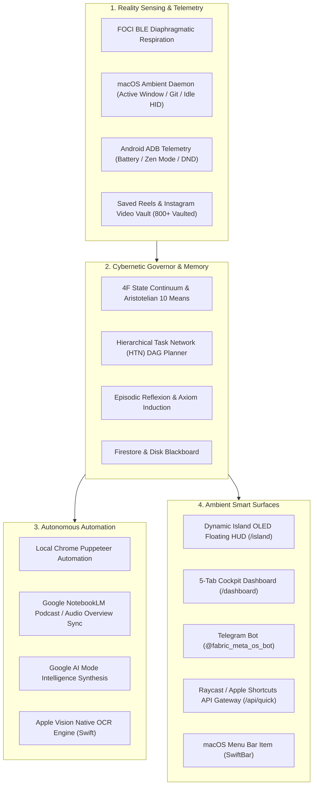

# ⚡ The Fabric: 4F Meta-OS

> **Autonomous Aristotelian Operating Mesh • Personal Telemetry, Agent Mesh & Knowledge Vault**  
> *Live Cockpit:* [fabric-one-sage.vercel.app](https://fabric-one-sage.vercel.app) • *Dynamic Island:* [fabric-one-sage.vercel.app/island](https://fabric-one-sage.vercel.app/island) • *Documentation:* [fabric-one-sage.vercel.app/docs](https://fabric-one-sage.vercel.app/docs)

---

## 🌌 What is Fabric OS?

**Fabric OS** is an agentic, cybernetic personal operating system designed to bridge high-agency philosophical principles (**Aristotle's 10 Golden Means** and the **4F Vector: Focus, Facts, Funds, Feedback**) with real-time reality sensing, wearable bio-telemetry, background automation, and force-directed knowledge graph synthesis.

Fabric eliminates digital cognitive fragmentation by orchestrating your physical devices, focus blocks, learning materials, and saved intelligence into an interconnected, autonomous system of systems.

---

## 🏛️ System Architecture



---

## ⚡ Key Capabilities

### 1. 📊 4F Telemetry & Aristotelian Radar
- Continuous tracking across the 4 core dimensions: **Focus**, **Facts**, **Funds**, and **Feedback**.
- 10-dimensional Aristotelian Radar polygon highlighting imbalances between excess and deficiency.
- FOCI wearable integration tracking diaphragmatic respiration, calm states, and deep flow.

### 2. 🔮 Dynamic Island HUD (`/island`)
- Apple-grade OLED glassmorphism interface (`#050508`) for Mac and iPad.
- Fluid fluid respiration wave mirroring real-time lung motion and cognitive focus.
- 1-tap quick action dock, radial focus timer, and live HTN Task DAG pills.

### 3. 🕸️ 97-Node Knowledge Graph Constellation (`/dashboard#graph`)
- Interactive force-directed canvas with Barnes-Hut repulsive physics.
- Cross-references 3,880 saved posts, 800+ Telegram streaming reels, Notion cards, and high-order philosophical heuristics.
- Zero-cold-start bundled fallback with inverse zoom-damped labels.

### 4. 🎓 IITM BS Quiz 1 Academy (`/dashboard#academy`)
- 179 parsed past exam questions across **Computer Networks**, **Computer Systems Design (CSD)**, and **Big Data & Biological Networks (BDBN)**.
- Step-by-step mathematical solutions with **Exam Trap** alerts.
- Live KaTeX formula cheat sheets ($d_{\text{trans}}$, Little's law, sliding window $\eta$, radix conversions, clustering coefficients).
- Publication-grade study notebooks optimized for Google **NotebookLM** ingestion.

### 5. ⚡ Hierarchical Task Network (HTN) Planner (`/dashboard#tasks`)
- Compiles natural language goals into topological DAG plans with Kahn's cycle-detection algorithm.
- Interactive SVG dependency graph displaying step states (`COMPLETED`, `RUNNING`, `FAILED`, `PENDING`), durations, and JSON execution outputs.

### 6. 🤖 Autonomous Telegram Bot (`@fabric_meta_os_bot`)
- `/prep [cn|csd|bdbn]` — Interactive active recall sparring with instant feedback.
- `/prep nlm [subject]` — Autonomous NotebookLM upload & podcast generation.
- `/task <goal>` — Natural language goal compilation and execution.
- `/spark` & `/settle` — 90-minute focus sprints and evening trade settlement.
- `/reflexion` — Episodic memory analysis mining high-yield cognitive multipliers.

---

## 🚀 Quick Start

### Prerequisites
- [Bun](https://bun.sh/) (v1.3+)
- Node.js (v20+)
- Google Chrome (installed at default macOS path)

```bash
# 1. Clone repository
git clone https://github.com/holy-script/fabric.git
cd fabric

# 2. Install dependencies
bun install

# 3. Configure environment
cp .env.example .env
# Fill in TELEGRAM_BOT_TOKEN, GEMINI_API_KEY, TELEGRAM_USER_ID

# 4. Run full test suite (113 tests, 0 failures)
bun test

# 5. Start development server
bun run dev
```

Visit [`http://localhost:3000`](http://localhost:3000) to open the Cockpit Dashboard.

---

## 📁 Repository Guide for AI Agents

For autonomous coding agents picking up tasks in new sessions, refer to the master architecture specification in [**`AGENTS.md`**](AGENTS.md) and [**`docs/EXPLAINABILITY_AND_EVOLUTION.md`**](docs/EXPLAINABILITY_AND_EVOLUTION.md).

---

*The Fabric OS Project • Built for Human-Machine Symbiosis*
