# The Fabric: 4F Meta-OS

<p align="left">
  
  
  
  
  
  
  
  
</p>

> **Autonomous Aristotelian Operating Mesh • Personal Telemetry, Agent Mesh & Force-Directed Knowledge Vault**

<p align="left">
  <a href="https://fabric-one-sage.vercel.app" target="_blank"><strong>Live Cockpit</strong></a> &bull;
  <a href="https://fabric-one-sage.vercel.app/island" target="_blank"><strong>Dynamic Island HUD</strong></a> &bull;
  <a href="https://fabric-one-sage.vercel.app/docs" target="_blank"><strong>Documentation Hub</strong></a> &bull;
  <a href="https://t.me/fabric_meta_os_bot" target="_blank"><strong>Telegram Bot (@fabric_meta_os_bot)</strong></a>
</p>

---

<!-- AUTO-DOC:SYSTEM_STATUS:START -->
> **Mesh State**: Active • **Memory Nodes**: 97 Knowledge Synapses • **Active Daemons**: macOS Ambient, Telegram Archiver, Insomnia Governor • **Test Suite**: 316 Tests Passing (0 Failures across 26 suites)
<!-- AUTO-DOC:SYSTEM_STATUS:END -->

---

## What is Fabric OS?

**Fabric OS** is an agentic, cybernetic personal operating system designed to bridge high-agency philosophical principles (**Aristotle's 10 Golden Means** and the **4F Vector: Focus, Facts, Funds, Feedback**) with continuous reality sensing, wearable bio-telemetry, background automation, and force-directed knowledge graph synthesis.

Fabric eliminates digital cognitive fragmentation by orchestrating physical devices, focus blocks, learning materials, and personal intelligence into an interconnected, autonomous system of systems.

---

## System Architecture

```mermaid
flowchart TD
    subgraph Sensing["1. Reality Sensing & Telemetry"]
        A1["FOCI BLE Diaphragmatic Respiration"]
        A2["macOS Ambient Daemon (Active Window / Git / Idle HID)"]
        A3["Android ADB Telemetry (Battery / Zen Mode / DND)"]
        A4["Saved Media & Video Vault (800+ Stream Records)"]
    end

    subgraph Cybernetics["2. Cybernetic Governor & Memory"]
        B1["4F State Continuum (Focus • Facts • Funds • Feedback)"]
        B2["Aristotelian 10 Means (Excess vs Deficiency Equilibrium)"]
        B3["Hierarchical Task Network (HTN) DAG Planner"]
        B4["Episodic Reflexion & Nightly Dream Consolidation"]
        B5["Barnes-Hut Force-Directed Knowledge Graph (97 Synapses)"]
    end

    subgraph Intelligence["3. Actuation, Intelligence & MCP"]
        C1["Fabric Model Context Protocol (MCP) Server (13 Tools)"]
        C2["Gemini Live Multimodal & Sub-300ms Socratic Voice"]
        C3["Local Chrome Puppeteer Automation & AI Mode Synthesis"]
        C4["Google NotebookLM Podcast / Audio Overview Sync"]
        C5["Apple Vision Native OCR Engine (Swift)"]
    end

    subgraph Surfaces["4. Ambient Smart Surfaces"]
        D1["Dynamic Island OLED Floating HUD (/island)"]
        D2["Camera Notch Desktop HUD (Fabric.app)"]
        D3["6-Tab Cockpit Dashboard (/dashboard)"]
        D4["Telegram Bot (@fabric_meta_os_bot)"]
        D5["macOS Menu Bar Item (SwiftBar) & Raycast Gateway"]
    end

    Sensing --> Cybernetics
    Cybernetics <--> Intelligence
    Intelligence --> Surfaces
    Cybernetics --> Surfaces
```



---

## Model Context Protocol (MCP) Integration

Fabric includes a full, production-grade **Model Context Protocol (MCP) Server** (`src/mcp/server.ts`). This allows AI coding agents in environments like **Antigravity**, **Claude Code**, or **Cursor** to directly interface with your personal operating system, query the knowledge graph, inspect bio-telemetry, and convene agent councils.

### Exposed MCP Tools

| Tool Identifier | Description | Key Arguments |
| :--- | :--- | :--- |
| `fabric_search_knowledge` | Hybrid vector & keyword search over 3,880+ vaulted intelligence records. | `query` (string), `domain` (optional), `limit` (int) |
| `fabric_get_telemetry` | Retrieves live 4F vector scores, FOCI breath coherence, and active focus sprint state. | *None* |
| `fabric_convene_council` | Convenes the 6 Socratic polymath personas (Socratic, Stoic, Architect, Quant, Biomechanic, Sceptic). | `topic` (string), `persona` (enum) |
| `fabric_get_cluster` | Returns force-directed subgraph cluster coordinates for specific knowledge domains. | `clusterId` (string) |
| `fabric_list_domains` | Enumerates all indexed domains (Engineering, Philosophy, Finance, Health). | *None* |
| `fabric_log_trade` | Logs financial positions and updates the Funds vector state. | `symbol`, `action`, `amount`, `notes` |
| `fabric_notify_user` | Dispatches high-priority notification to macOS Toast, Dynamic Island, and Telegram. | `message` (string), `priority` (`low` \| `high` \| `critical`) |
| `fabric_web_search` | Real-time headless search via Google AI Mode and summarizer. | `query` (string) |
| `fabric_calendar_block` | Allocates a protected focus block or IITM study sprint on Google Calendar. | `title`, `startTime`, `durationMinutes` |
| `fabric_calendar_track` | Logs time spent on active HTN task nodes against calendar allocations. | `taskId`, `actualMinutes` |
| `fabric_calendar_list` | Fetches today's agenda with cognitive load estimations. | `date` (ISO string) |
| `fabric_sync_calendar_notion` | Bi-directional synchronization between Google Calendar events and Notion cards. | *None* |
| `fabric_deep_research` | Autonomous multi-step literature and web research synthesizer. | `topic` (string), `maxDepth` (int) |

---

## Core Capabilities

### 1. 4F Telemetry & Aristotelian Radar
- Continuous monitoring across four vectors: **Focus**, **Facts**, **Funds**, and **Feedback**.
- 10-dimensional Aristotelian Radar polygon highlighting deviations between excess and deficiency.
- **FOCI BLE wearable integration** tracking real-time diaphragmatic respiration, calm states, and deep flow.

### 2. Dynamic Island HUD (`/island`) & Camera Notch HUD (`Fabric.app`)
- Apple-grade OLED glassmorphism interface (`#050508`) for macOS and iPad.
- Fluid respiration wave dynamically mirroring lung expansion and cognitive coherence.
- 1-tap quick action dock, radial focus timer, and live HTN Task DAG execution pills.
- Borderless native camera notch overlay (`dist/Fabric.app`) anchored to MacBook hardware bezels.

### 3. 97-Node Force-Directed Knowledge Constellation (`/dashboard#graph`)
- Interactive physics canvas powered by Barnes-Hut repulsion and spring tension.
- Cross-references 3,880 saved posts, 800+ Telegram streaming reels, Notion cards, and high-order philosophical heuristics.
- Zero-cold-start bundled fallback with inverse zoom-damped typography.

### 4. IITM BS Quiz 1 Academy (`/dashboard#academy`)
- 179 parsed past exam questions across **Computer Networks**, **Computer Systems Design (CSD)**, and **Big Data & Biological Networks (BDBN)**.
- Step-by-step mathematical solutions with **Exam Trap** alerts.
- Live KaTeX formula cheat sheets ($d_{\text{trans}}$, Little's law, sliding window $\eta$, radix conversions, clustering coefficients).
- Automated ingestion pipeline syncing notes to Google **NotebookLM** for on-demand audio podcast overviews.

### 5. Hierarchical Task Network (HTN) Planner (`/dashboard#tasks`)
- Compiles natural language goals into topological DAG plans with Kahn's cycle-detection algorithm.
- Interactive SVG dependency graph tracking node states (`COMPLETED`, `RUNNING`, `FAILED`, `PENDING`), durations, and JSON execution outputs.

### 6. Sonic Mind & FabricPipe (`/dashboard#sonic`)
- **Semantic Music Memory Vault**: Stores personal resonance, emotional memories, 4F focus vector affinities, and energy levels (1-10) for every YouTube track.
- **Bi-Directional Cloud Synchronization**: Delta sync engine (`/api/music/sync`) integrating with our custom NewPipe Android build (`fabric-newpipe`).
- **Goal-Oriented AI DJ**: Synthesizes custom mixes based on current activity with spaced repetition for forgotten tracks.

### 7. Autonomous Telegram Bot (`@fabric_meta_os_bot`)
- `/spin <name> <prompt>` — Scaffold git repository with `AGENTS.md` and launch Google Antigravity.
- `/song <url> [context]` & `/mix <intent>` — Capture YouTube gems with personal context and generate dynamic mixes.
- `/prep [cn|csd|bdbn]` — Interactive active recall sparring with instant feedback.
- `/prep nlm [subject]` — Autonomous NotebookLM upload & podcast generation.
- `/task <goal>` — Natural language goal compilation and HTN swarm execution.
- `/spark` & `/settle` — 90-minute focus sprints and evening trade settlement.
- `/reflexion` & `/consolidate` — Episodic memory analysis & nightly dream consolidation.

### 8. Sub-300ms Socratic Real-Time Voice Channel (`/api/voice`)
- Bidirectional voice sparring bridge with multi-persona Edge-TTS neural speech synthesis and Gemini Live multimodal frames.
- Specialized polymath council personas: `Socratic`, `Stoic`, `Architect`, `Quant`, `Biomechanic`, and `Sceptic`.

### 9. Closed-Loop Cybernetic Governor
- Feedback governor continuously minimizing existential loss function $\mathcal{L}(\mathbf{S})$.
- 4 homeostatic boundary checks (Excessive Focus $>+3$, Depleted Vitality $<-2$, Sedentary $>75\text{m}$, Feedback dispersion).
- 3-tier progressive actuation cascade: Dynamic Island badge $\to$ macOS Notification toast $\to$ Android ADB Zen lock.

---

## Deterministic Daemon & CLI Control

The Fabric runtime orchestrates autonomous background daemons managed via unified CLI flags:

```bash
# 1. Inspect running background workers
$ ./dist/Fabric --daemons
[DAEMON] macOS Ambient Sensor (PID: 48921)   -> RUNNING (Idle: 12s | Window: Cursor)
[DAEMON] FOCI BLE Respiration (PID: 48934)   -> CONNECTED (Rate: 14 bpm | Coherence: 0.88)
[DAEMON] Telegram Archiver   (PID: 48945)   -> IDLE (812 Reels Vaulted)
[DAEMON] Cybernetic Governor (PID: 48950)   -> ACTIVE (Loss: 0.12 | Equilibrium: Optimal)

# 2. Convene Polymath Council via CLI
$ bun run src/cli.ts council --topic "Balancing deep work sprint with evening recovery"
[COUNCIL] Convening 6 Personas...
[STOIC]      "Do not measure the day by tasks conquered, but by stillness preserved."
[QUANT]      "Focus vector: +2.8. Marginal cognitive yield decaying. Recommend settle at 22:00."
[ARCHITECT]  "HTN DAG Step 4 completed. Remaining 2 nodes can safely defer to tomorrow."
[GOVERNOR]   Actuation: Triggering /settle memo & dimming Dynamic Island OLED.
```

---

## Quickstart

### Prerequisites
- [Bun](https://bun.sh/) (v1.3+)
- Node.js (v20+)
- Google Chrome (installed at default macOS path)

```bash
# 1. Clone repository
git clone https://github.com/holy-script/fabric.git
cd fabric

# 2. Install dependencies
bun install

# 3. Configure environment
cp .env.example .env
# Set TELEGRAM_BOT_TOKEN, GEMINI_API_KEY, TELEGRAM_USER_ID, FIREBASE credentials

# 4. Run full test suite (316 tests across 26 suites)
bun test

# 5. Start development server
bun run dev

# 6. Launch native macOS Desktop App & Camera Notch HUD
./scripts/shortcuts/build_notch.sh
open dist/Fabric.app
```

Visit [`http://localhost:3000`](http://localhost:3000) to open the Cockpit Dashboard, or [`http://localhost:3000/island`](http://localhost:3000/island) for the Dynamic Island HUD.

---

## Repository Guide for AI Agents

For autonomous coding agents picking up tasks in new sessions, refer to the master architecture specification in [**`AGENTS.md`**](AGENTS.md), [**`GEMINI.md`**](GEMINI.md), and [**`docs/EXPLAINABILITY_AND_EVOLUTION.md`**](docs/EXPLAINABILITY_AND_EVOLUTION.md).

---

<!-- AUTO-DOC:FOOTER:START -->
*The Fabric OS Project • Autonomous Aristotelian Operating Mesh • Built for Human-Machine Symbiosis*
<!-- AUTO-DOC:FOOTER:END -->
