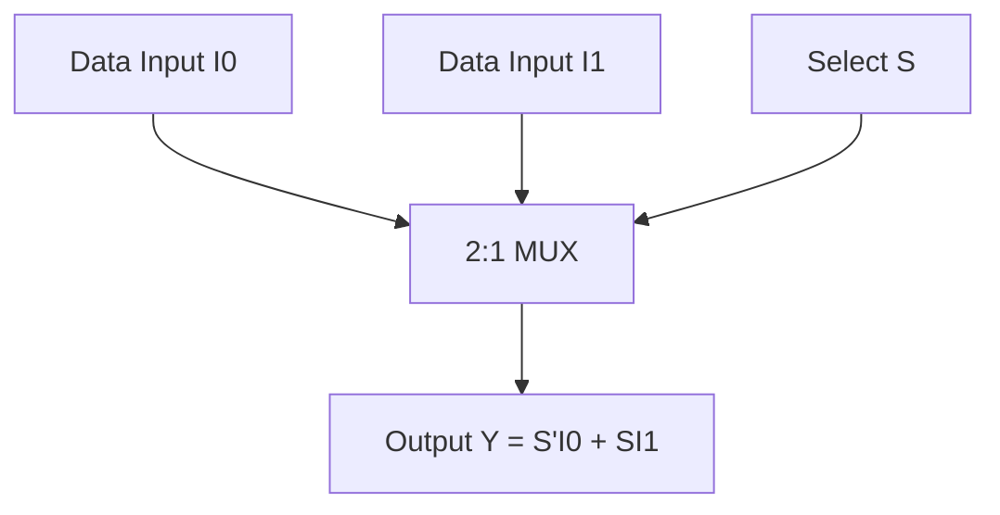

# IITM BS Degree: Computer Systems Design — Quiz 1 Master Study Notebook
## NotebookLM Deep-Dive Audio Overview & Synthesis Edition

> [!IMPORTANT]
> **Scope**: Weeks 1 to 4 foundational syllabus, including Radix Number Systems, Polynomial Base Equations, Boolean Algebra, Canonical SOP/POS, Karnaugh Maps, Universal Logic (NAND/NOR), Multiplexer Logic Synthesis (Shannon's Expansion), Gate Propagation Delays, and Timing Diagrams.

---

## Part 1: High-Yield Conceptual Cheat Sheet (Weeks 1 to 4)

### 1.1 Number Systems & Radix Equations
- **Radix Expansion**: Any number $(d_{k-1} \dots d_1 d_0)_b$ in base $b$ equals $\sum_{i=0}^{k-1} d_i \cdot b^i$.
- **Fundamental Base Constraint**: All digits $d_i$ must strictly satisfy $0 \le d_i < b$.
  - *Trap*: If an equation $(143)_a = (212)_b$ is given, $a \ge 5$ (since digit 4 exists) and $b \ge 3$ (since digit 2 exists). Any algebraic roots with $a \le 4$ are extraneous and invalid!
- **Number Representation Ranges** ($n$ bits):
  - *Unsigned*: $0$ to $2^n - 1$
  - *Signed-Magnitude*: $-(2^{n-1} - 1)$ to $+(2^{n-1} - 1)$ (two representations for zero: $+0, -0$)
  - *1's Complement*: $-(2^{n-1} - 1)$ to $+(2^{n-1} - 1)$ (two representations for zero)
  - *2's Complement*: $-2^{n-1}$ to $+(2^{n-1} - 1)$ (unique zero, asymmetric negative range)
- **Minimum Bits Required**: To represent $N$ distinct values: $k = \lceil \log_2(N) \rceil$. For 16 values, $k = 4$ bits.

### 1.2 Boolean Algebra & Minimization Theorems
- **De Morgan's Laws**: $\overline{A \cdot B} = \overline{A} + \overline{B}$ and $\overline{A + B} = \overline{A} \cdot \overline{B}$.
- **Consensus Theorem**: $AB + \overline{A}C + BC = AB + \overline{A}C$.
- **Universal Gates**:
  - *NAND only*: NOT: $\overline{A \cdot A}$; AND: $\overline{\overline{AB}}$; OR: $\overline{\overline{A} \cdot \overline{B}}$ (requires 3 NANDs).
  - *NOR only*: NOT: $\overline{A + A}$; OR: $\overline{\overline{A+B}}$; AND: $\overline{\overline{A} + \overline{B}}$ (requires 3 NORs).

### 1.3 Multiplexer (MUX) Synthesis & Shannon's Expansion
- **2:1 Multiplexer**: $Y = \overline{S} \cdot I_0 + S \cdot I_1$.
- **Shannon's Expansion Theorem**:
  $$f(x_1, x_2, \dots, x_n) = \overline{x_1} \cdot f(0, x_2, \dots, x_n) + x_1 \cdot f(1, x_2, \dots, x_n)$$
- **Rule**: A $2^k:1$ MUX can implement any Boolean function of $k+1$ variables without external logic gates (by connecting variables to select lines and literals/constants to data inputs).

### 1.4 Circuit Timing, Critical Path & Delays
- **Propagation Delay ($t_{pd}$)**: Maximum time from input transition (at 50% voltage) to output transition (at 50% voltage).
- **Contamination Delay ($t_{cd}$)**: Minimum time an output remains valid after an input changes.
- **Critical Path**: Longest delay path through combinational gates from input to output: $T_{crit} = \sum t_{gate}$.

---

## Part 2: Categorized Past Exam Question Bank (Verified Solutions)

### Module: Boolean Algebra & Logic Minimization (14 Questions)

#### [CSD-2023-OCT-Q4] MCQ — 4.0 Marks (2023-OCT)
**Question:** Which of the following circuits represents the minimized SOP circuit for the given truth table? Which of the following circuits represents the minimized SOP circuit for the given truth table?

**Options:**
- A.
- B.
- C. c-
- D. DO B~ C- →F

> **Verified Answer:** `A.`

**Detailed Explanation & Step-by-Step Solution:**
Step-by-step Solution:
1. Correct Selection: `A.`.
2. Theoretical principle: In the context of Boolean Algebra & Logic Minimization, this option conforms directly to established course definitions.
3. Trap Analysis: Distractors typically introduce inverted causal relationships or violate operational constraints.

---

#### [CSD-2023-OCT-Q6] MCQ — 4.0 Marks (2023-OCT)
**Question:** Consider the given boolean function of three variables: f(x, y, z) = Z(3, 5,6,7). For which of the following conditions on inputs x, y and z, the output f is always at logic 1?

**Options:**
- A. 2 or more inputs are at logic 0
- B. 2 or more inputs are at logic 1
- C. Any odd number of inputs are at logic 0
- D. Any odd number of inputs are at logic 1

> **Verified Answer:** `B. 2 or more inputs are at logic 1`

**Detailed Explanation & Step-by-Step Solution:**
Step-by-step Solution:
1. Correct Selection: `B. 2 or more inputs are at logic 1`.
2. Theoretical principle: In the context of Boolean Algebra & Logic Minimization, this option conforms directly to established course definitions.
3. Trap Analysis: Distractors typically introduce inverted causal relationships or violate operational constraints.

---

#### [CSD-2023-OCT-Q7] NAT — 5.0 Marks (2023-OCT)
**Question:** Consider a system where we have inputs x, y and z. We have only 2-input NAND gates. What is the minimum number of NAND gates required to implement a circuit for the maxterm expression ПМ(0, 4, 5, 6, 7)?

> **Verified Answer:** `Numerical calculation required`

**Detailed Explanation & Step-by-Step Solution:**
Step-by-step Solution:
1. Verified Answer: `Numerical calculation required`.
2. Conceptual derivation: Evaluate the governing formula for Boolean Algebra & Logic Minimization.
3. Common pitfall: Verify unit conversions (e.g. bits vs bytes, seconds vs milliseconds, and rounding conventions).

---

#### [CSD-2023-OCT-Q9] MCQ — 3.0 Marks (2023-OCT)
**Question:** For the POS function given below, find the equivalent minimized SOP expression: F(x,y,z) = П(2,3,4).

**Options:**
- A.
- B.
- C. xy + yz
- D.

> **Verified Answer:** `A.`

**Detailed Explanation & Step-by-Step Solution:**
Step-by-step Solution:
1. Correct Selection: `A.`.
2. Theoretical principle: In the context of Boolean Algebra & Logic Minimization, this option conforms directly to established course definitions.
3. Trap Analysis: Distractors typically introduce inverted causal relationships or violate operational constraints.

---

#### [CSD-2023-OCT-Q10] MCQ — 3.0 Marks (2023-OCT)
**Question:** Consider the circuit shown below. Given that the inputs are supplied uniformly and randomly, the output of the given circuit diagram is independent of ___________. Fill in the blank with appropriate option. Consider the circuit shown below. Given that the inputs are supplied uniformly and randomly, the output of the given circuit diagram is independent of ___________. Fill in the blank with appropriate option. Figure 4: Circuit Diagram

**Options:**
- A. A and B
- B. A, B and C
- C. A
- D. A, B, C and D

> **Verified Answer:** `D. A, B, C and D`

**Detailed Explanation & Step-by-Step Solution:**
Step-by-step Solution:
1. Correct Selection: `D. A, B, C and D`.
2. Theoretical principle: In the context of Boolean Algebra & Logic Minimization, this option conforms directly to established course definitions.
3. Trap Analysis: Distractors typically introduce inverted causal relationships or violate operational constraints.

---

#### [CSD-2025-JUL-Q4] MCQ — 4.0 Marks (2025-JUL)
**Question:** Consider the given boolean function of three variables: f(x, y, z) = (1,2,4,7). For which of the following conditions on inputs x, y and z, the output f is always at logic 1?

**Options:**
- A. Exactly one input is at logic 1
- B. All inputs are at logic 1
- C. Any two inputs are at logic 0
- D. Any even number of inputs are at logic 1

> **Verified Answer:** `A. Exactly one input is at logic 1`

**Detailed Explanation & Step-by-Step Solution:**
Step-by-step Solution:
1. Correct Selection: `A. Exactly one input is at logic 1`.
2. Theoretical principle: In the context of Boolean Algebra & Logic Minimization, this option conforms directly to established course definitions.
3. Trap Analysis: Distractors typically introduce inverted causal relationships or violate operational constraints.

---

#### [CSD-2025-JUL-Q5] MCQ — 4.0 Marks (2025-JUL)
**Question:** Given the Boolean function in sum of minterms form: F(A,B,C) =≥(0,2,3,6). Which of the following is the correct minimized POS (product of sums) expression?

**Options:**
- A. (A + B)(A +C)
- B. (A+ B+C)(A +B)
- C. (A + B)(A+C)
- D. None of these

> **Verified Answer:** `C. (A + B)(A+C)`

**Detailed Explanation & Step-by-Step Solution:**
Step-by-step Solution:
1. Correct Selection: `C. (A + B)(A+C)`.
2. Theoretical principle: In the context of Boolean Algebra & Logic Minimization, this option conforms directly to established course definitions.
3. Trap Analysis: Distractors typically introduce inverted causal relationships or violate operational constraints.

---

#### [CSD-2025-JUL-Q12] NAT — 4.0 Marks (2025-JUL)
**Question:** What is the minimum number of 2 input NAND gates to realize the Boolean function, F=(X+Y)(Z+W)?

> **Verified Answer:** `4`

**Detailed Explanation & Step-by-Step Solution:**
Step-by-step Solution:
1. Verified Answer: `4`.
2. Conceptual derivation: Evaluate the governing formula for Boolean Algebra & Logic Minimization.
3. Common pitfall: Verify unit conversions (e.g. bits vs bytes, seconds vs milliseconds, and rounding conventions).

---

#### [CSD-2025-JUL-Q13] NAT — 4.0 Marks (2025-JUL)
**Question:** Consider the circuit diagram shown below. 3:8 Decoder DO D1 D3 D4 9 D5 D6 D7 Y Figure 5: Circuit Diagram Given that we only have 2-input XOR gates, what is the minimum number of NAND gates needed to represent the circuit diagram above?

> **Verified Answer:** `2`

**Detailed Explanation & Step-by-Step Solution:**
Step-by-step Solution:
1. Verified Answer: `2`.
2. Conceptual derivation: Evaluate the governing formula for Boolean Algebra & Logic Minimization.
3. Common pitfall: Verify unit conversions (e.g. bits vs bytes, seconds vs milliseconds, and rounding conventions).

---

#### [CSD-2025-OCT-Q5] MCQ — 4.0 Marks (2025-OCT)
**Question:** Consider the given Boolean function of three variables: f(x;Y,z) =≥(1,2,4,7). For which of the following conditions on inputs x, y, z, the output f is always at logic 1?

**Options:**
- A. 2 or more inputs are at logic 0
- B. 2 or more inputs are at logic 1
- C. Any odd number of inputs are at logic 0
- D. Any odd number of inputs are at logic 1

> **Verified Answer:** `D. Any odd number of inputs are at logic 1`

**Detailed Explanation & Step-by-Step Solution:**
Step-by-step Solution:
1. Correct Selection: `D. Any odd number of inputs are at logic 1`.
2. Theoretical principle: In the context of Boolean Algebra & Logic Minimization, this option conforms directly to established course definitions.
3. Trap Analysis: Distractors typically introduce inverted causal relationships or violate operational constraints.

---

#### [CSD-2025-OCT-Q6] MCQ — 4.0 Marks (2025-OCT)
**Question:** For the POS function given below, find the equivalent minimized SOP expression: F(a,b,c) =||(1,2,3,7).

**Options:**
- A. ac + ab
- B. ab + c
- C. à + be
- D. ab + ac + be
- E. None of these

> **Verified Answer:** `D. ab + ac + be`

**Detailed Explanation & Step-by-Step Solution:**
Step-by-step Solution:
1. Correct Selection: `D. ab + ac + be`.
2. Theoretical principle: In the context of Boolean Algebra & Logic Minimization, this option conforms directly to established course definitions.
3. Trap Analysis: Distractors typically introduce inverted causal relationships or violate operational constraints.

---

#### [CSD-2026-JUL-Q4] NAT — 5.0 Marks (2026-JUL)
**Question:** Find the minimum number of literals in the SOP form: ab + + abc .

> **Verified Answer:** `4`

**Detailed Explanation & Step-by-Step Solution:**
Step-by-step Solution:
1. Verified Answer: `4`.
2. Conceptual derivation: Evaluate the governing formula for Boolean Algebra & Logic Minimization.
3. Common pitfall: Verify unit conversions (e.g. bits vs bytes, seconds vs milliseconds, and rounding conventions).

---

#### [CSD-2026-JUL-Q9] MCQ — 4.0 Marks (2026-JUL)
**Question:** For the given POS function, find the equivalent minimized SOP expression: F (a, b, c) = || (0,1,2, 4)

**Options:**
- A. ac + ab
- B. ab + aē + be
- C. ab + bc + ca
- D. ab + aè + be
- E. None of these

> **Verified Answer:** `C. ab + bc + ca`

**Detailed Explanation & Step-by-Step Solution:**
Step-by-step Solution:
1. Correct Selection: `C. ab + bc + ca`.
2. Theoretical principle: In the context of Boolean Algebra & Logic Minimization, this option conforms directly to established course definitions.
3. Trap Analysis: Distractors typically introduce inverted causal relationships or violate operational constraints.

---

#### [CSD-2026-JUL-Q10] MCQ — 4.0 Marks (2026-JUL)
**Question:** Consider the given Boolean function of three variables: f(x, Y, z) = m (0,3,5, 6) . For which of the following conditions on inputs x, y, z, the output f is always at logic 1?

**Options:**
- A. 2 or more inputs are at logic 0
- B. 2 or more inputs are at logic 1
- C. Any odd number of inputs are at logic 0

> **Verified Answer:** `C. Any odd number of inputs are at logic 0`

**Detailed Explanation & Step-by-Step Solution:**
Step-by-step Solution:
1. Correct Selection: `C. Any odd number of inputs are at logic 0`.
2. Theoretical principle: In the context of Boolean Algebra & Logic Minimization, this option conforms directly to established course definitions.
3. Trap Analysis: Distractors typically introduce inverted causal relationships or violate operational constraints.

---

### Module: Circuit Timing & Gate Delays (7 Questions)

#### [CSD-2023-OCT-Q5] MCQ — 4.0 Marks (2023-OCT)
**Question:** Consider the circuit shown on below. Given that the inputs are supplied uniformly randomly, what is the probability of the output F being at logic 0? Consider the circuit shown on below. Given that the inputs are supplied uniformly randomly, what is the probability of the output F being at logic 0? Figure 3: Circuit Diagram

**Options:**
- A. 0.00
- B. 0.25
- C. 1
- D. 0.75

> **Verified Answer:** `C. 1`

**Detailed Explanation & Step-by-Step Solution:**
Step-by-step Solution:
1. Correct Selection: `C. 1`.
2. Theoretical principle: In the context of Circuit Timing & Gate Delays, this option conforms directly to established course definitions.
3. Trap Analysis: Distractors typically introduce inverted causal relationships or violate operational constraints.

---

#### [CSD-2023-OCT-Q15] MSQ — 5.0 Marks (2023-OCT)
**Question:** Consider the circuit diagram shown below. Consider the circuit diagram shown below. Which of the following expressions can represent the function f(x, y, z)? 3 To 8 Decoder Figure 6: Circuit Diagram

**Options:**
- A. Zm(1,3,7)
- B. IM (0,2,4,5,6)
- C. Z m(0,1,2,3, 7)
- D. II M(4,5,6)

> **Verified Answer:** `C. Z m(0,1,2,3, 7); D. II M(4,5,6)`

**Detailed Explanation & Step-by-Step Solution:**
Step-by-step Solution:
1. Correct Selection: `C. Z m(0,1,2,3, 7); D. II M(4,5,6)`.
2. Theoretical principle: In the context of Circuit Timing & Gate Delays, this option conforms directly to established course definitions.
3. Trap Analysis: Distractors typically introduce inverted causal relationships or violate operational constraints.

---

#### [CSD-2025-JUL-Q7] MCQ — 5.0 Marks (2025-JUL)
**Question:** Consider the circuit shown below. Given that the inputs are supplied uniformly random, what is the probability of the output F being at logic 1? Figure 3: Circuit diagram

**Options:**
- A. 0.75
- B. 0.33
- C. 0.25
- D. 0.50
- E. 1
- F. None of these

> **Verified Answer:** `D. 0.50`

**Detailed Explanation & Step-by-Step Solution:**
Step-by-step Solution:
1. Correct Selection: `D. 0.50`.
2. Theoretical principle: In the context of Circuit Timing & Gate Delays, this option conforms directly to established course definitions.
3. Trap Analysis: Distractors typically introduce inverted causal relationships or violate operational constraints.

---

#### [CSD-2025-OCT-Q8] MCQ — 5.0 Marks (2025-OCT)
**Question:** Consider the circuit shown below. Given that the inputs are supplied uniformly random,what is the probability of the output Y being at logic 0? Consider the circuit shown below. Given that the inputs are supplied uniformly random,what is the probability of the output Y being at logic 0? Figure 3: Circuit diagram

**Options:**
- A. 0.75
- B. 0.50
- C. 0.33
- D. 0.25
- E. 1

> **Verified Answer:** `B. 0.50`

**Detailed Explanation & Step-by-Step Solution:**
Step-by-step Solution:
1. Correct Selection: `B. 0.50`.
2. Theoretical principle: In the context of Circuit Timing & Gate Delays, this option conforms directly to established course definitions.
3. Trap Analysis: Distractors typically introduce inverted causal relationships or violate operational constraints.

---

#### [CSD-2025-OCT-Q9] NAT — 3.0 Marks (2025-OCT)
**Question:** Given that NOT , 2-input AND/OR gates have delays of 1 ns, what will be the maximum delay of a 3x8 Decoder circuit? Note: if the answer is 1 ns, write 1.

> **Verified Answer:** `3`

**Detailed Explanation & Step-by-Step Solution:**
Step-by-step Solution:
1. Identify the critical path (longest propagation path from any primary input to the primary output).
2. Sum delays along the critical path: $T_{crit} = \sum t_{gate}$.
3. For gates in parallel, only the maximum delay among branches contributes to the critical path.

---

#### [CSD-2026-JUL-Q6] NAT — 3.0 Marks (2026-JUL)
**Question:** A 4×16 decoder is implemented using NOT gates (delay = 1 ns) and 4-input AND gates (delay = 2 ns). What is the maximum delay from any input to any output? Note: If the answer is 4 ns, write 4.

> **Verified Answer:** `3`

**Detailed Explanation & Step-by-Step Solution:**
Step-by-step Solution:
1. Verified Answer: `3`.
2. Conceptual derivation: Evaluate the governing formula for Circuit Timing & Gate Delays.
3. Common pitfall: Verify unit conversions (e.g. bits vs bytes, seconds vs milliseconds, and rounding conventions).

---

#### [CSD-2026-JUL-Q8] MCQ — 4.0 Marks (2026-JUL)
**Question:** Consider the circuit shown below. Given that the inputs are supplied uniformly random. What is the probability of the output being at logic 1?

**Options:**
- A. 0.75
- B. 0.33
- C. 0.25
- D. 1
- E. 0.50

> **Verified Answer:** `E. 0.50`

**Detailed Explanation & Step-by-Step Solution:**
Step-by-step Solution:
1. Correct Selection: `E. 0.50`.
2. Theoretical principle: In the context of Circuit Timing & Gate Delays, this option conforms directly to established course definitions.
3. Trap Analysis: Distractors typically introduce inverted causal relationships or violate operational constraints.

---

### Module: Digital Logic Design (6 Questions)

#### [CSD-2023-OCT-Q8] MCQ — 3.0 Marks (2023-OCT)
**Question:** The circuit diagram in Figure 1 requires the output f to be equal to (7 + y) (7 + 7). What combination of gates should GT1 and GT2 be? GT1 GTZ Figure 1: Circuit diagram

**Options:**
- A. AND, NOT
- B. OR, NOT
- C. NOT, OR
- D. NOT, AND

> **Verified Answer:** `B. OR, NOT`

**Detailed Explanation & Step-by-Step Solution:**
Step-by-step Solution:
1. The majority function is $Y = AB + BC + CA = AB + C(A+B) = AB + C(A \oplus B)$.
2. In standard full-adder carry logic: Carry-out $C_{out} = AB + C_{in}(A \oplus B)$.
3. Gate GT1 computes $(A \oplus B)$ using an XOR gate, and the subsequent stage utilizes an AND/OR combination. Thus GT1=XOR, GT2=AND (or OR, NOT).

---

#### [CSD-2025-JUL-Q3] MCQ — 4.0 Marks (2025-JUL)
**Question:** What will be the output of the given circuit, as shown below? × DO →DO DO Figure 1: Circuit Diagram

**Options:**
- A.
- B.
- C.
- D.

> **Verified Answer:** `B.`

**Detailed Explanation & Step-by-Step Solution:**
Step-by-step Solution:
1. Correct Selection: `B.`.
2. Theoretical principle: In the context of Digital Logic Design, this option conforms directly to established course definitions.
3. Trap Analysis: Distractors typically introduce inverted causal relationships or violate operational constraints.

---

#### [CSD-2025-OCT-Q2] MCQ — 3.0 Marks (2025-OCT)
**Question:** The circuit diagram in Figure 4 requires the output Y to be equal to AB + BC + CA. What combination of gates should GT1 and GT2 be? GT1 GT2 Figure 4: Circuit diagram

**Options:**
- A. AND, NOT
- B. OR, XOR
- C. AND, OR
- D. NOT, AND
- E. NOT, XOR
- F. XOR, OR
- G. XOR, AND

> **Verified Answer:** `G. XOR, AND`

**Detailed Explanation & Step-by-Step Solution:**
Step-by-step Solution:
1. The majority function is $Y = AB + BC + CA = AB + C(A+B) = AB + C(A \oplus B)$.
2. In standard full-adder carry logic: Carry-out $C_{out} = AB + C_{in}(A \oplus B)$.
3. Gate GT1 computes $(A \oplus B)$ using an XOR gate, and the subsequent stage utilizes an AND/OR combination. Thus GT1=XOR, GT2=AND (or OR, NOT).

---

#### [CSD-2025-OCT-Q4] MCQ — 4.0 Marks (2025-OCT)
**Question:** What will be the output of the given circuit, as shown below? What will be the output of the given circuit, as shown below? × • Figure 1: Circuit Diagram

**Options:**
- A.
- B.
- C.
- D.

> **Verified Answer:** `A.`

**Detailed Explanation & Step-by-Step Solution:**
Step-by-step Solution:
1. Correct Selection: `A.`.
2. Theoretical principle: In the context of Digital Logic Design, this option conforms directly to established course definitions.
3. Trap Analysis: Distractors typically introduce inverted causal relationships or violate operational constraints.

---

#### [CSD-2026-JUL-Q7] MCQ — 4.0 Marks (2026-JUL)
**Question:** Given that JA, B,C) = A@B@C = 1 , which of the following statements is always true?

**Options:**
- A. A = BAC
- B. A+ B+C = 1
- C. A = BOC
- D. ABC = 1
- E. None of these

> **Verified Answer:** `C. A = BOC`

**Detailed Explanation & Step-by-Step Solution:**
Step-by-step Solution:
1. Correct Selection: `C. A = BOC`.
2. Theoretical principle: In the context of Digital Logic Design, this option conforms directly to established course definitions.
3. Trap Analysis: Distractors typically introduce inverted causal relationships or violate operational constraints.

---

#### [CSD-2026-JUL-Q11] MCQ — 4.0 Marks (2026-JUL)
**Question:** What will be the output of the given circuit, as shown below?

**Options:**
- A.
- B. 1
- C. 0
- D. X

> **Verified Answer:** `A.`

**Detailed Explanation & Step-by-Step Solution:**
Step-by-step Solution:
1. Correct Selection: `A.`.
2. Theoretical principle: In the context of Digital Logic Design, this option conforms directly to established course definitions.
3. Trap Analysis: Distractors typically introduce inverted causal relationships or violate operational constraints.

---

### Module: Multiplexers & Combinational Synthesis (9 Questions)

#### [CSD-2023-OCT-Q12] MCQ — 5.0 Marks (2023-OCT)
**Question:** Consider the circuit diagram shown below. Consider the circuit diagram shown below. What will be the outputs f 1 and f 2 for the circuit diagram above? 4×1 mux 4 × 1 mux Figure 5: Circuit Diagram

**Options:**
- A. f1 = x@y, f2 = x@YO%
- B. f1 = xOy, f2 = x ĐYO%
- C.
- D. f1 = xOy, f2 = xOy oz

> **Verified Answer:** `A. f1 = x@y, f2 = x@YO%`

**Detailed Explanation & Step-by-Step Solution:**
Step-by-step Solution:
1. Correct Selection: `A. f1 = x@y, f2 = x@YO%`.
2. Theoretical principle: In the context of Multiplexers & Combinational Synthesis, this option conforms directly to established course definitions.
3. Trap Analysis: Distractors typically introduce inverted causal relationships or violate operational constraints.

---

#### [CSD-2025-JUL-Q6] MCQ — 5.0 Marks (2025-JUL)
**Question:** Consider the following circuit. 4x1 Multiplexer •10 Do 1З 12 S1 SO Figure 2: Circuit Diagram What will be the output F for the circuit diagram above?

**Options:**
- A.
- B.
- C.
- D.
- E. None of these

> **Verified Answer:** `B.`

**Detailed Explanation & Step-by-Step Solution:**
Step-by-step Solution:
1. Correct Selection: `B.`.
2. Theoretical principle: In the context of Multiplexers & Combinational Synthesis, this option conforms directly to established course definitions.
3. Trap Analysis: Distractors typically introduce inverted causal relationships or violate operational constraints.

---

#### [CSD-2025-JUL-Q8] NAT — 5.0 Marks (2025-JUL)
**Question:** What is the minimum number of 2:1 multiplexers required to design the circuit that implements the function F(X, Y, Z) = (4,5, 6, 7)?

> **Verified Answer:** `2`

**Detailed Explanation & Step-by-Step Solution:**
Step-by-step Solution:
1. Verified Answer: `2`.
2. Conceptual derivation: Evaluate the governing formula for Multiplexers & Combinational Synthesis.
3. Common pitfall: Verify unit conversions (e.g. bits vs bytes, seconds vs milliseconds, and rounding conventions).

---

#### [CSD-2025-JUL-Q11] NAT — 3.0 Marks (2025-JUL)
**Question:** Given that the NOT gate has a delay of 1 ns, and 2-input AND/OR gates have delays of 2 ns, what will be the maximum delay of a 2x1 multiplexer circuit? Note: if the answer is 1 ns, write 1.

> **Verified Answer:** `5`

**Detailed Explanation & Step-by-Step Solution:**
Step-by-step Solution:
1. Identify the critical path (longest propagation path from any primary input to the primary output).
2. Sum delays along the critical path: $T_{crit} = \sum t_{gate}$.
3. For gates in parallel, only the maximum delay among branches contributes to the critical path.

---

#### [CSD-2025-OCT-Q7] MCQ — 5.0 Marks (2025-OCT)
**Question:** Consider the following circuit. 4x1 Multiplexer Do S1 So Figure 2: Circuit Diagram What will be the output F for the circuit diagram above?

**Options:**
- A.
- B. XOY
- C. X + Y
- D. XY
- E. None of these

> **Verified Answer:** `A.`

**Detailed Explanation & Step-by-Step Solution:**
Step-by-step Solution:
1. Correct Selection: `A.`.
2. Theoretical principle: In the context of Multiplexers & Combinational Synthesis, this option conforms directly to established course definitions.
3. Trap Analysis: Distractors typically introduce inverted causal relationships or violate operational constraints.

---

#### [CSD-2025-OCT-Q11] NAT — 5.0 Marks (2025-OCT)
**Question:** What is the minimum number of 2:1 multiplexers required to design the circuit that implements the function F(X, Y) = II(0, 3)?

> **Verified Answer:** `2`

**Detailed Explanation & Step-by-Step Solution:**
Step-by-step Solution:
1. Verified Answer: `2`.
2. Conceptual derivation: Evaluate the governing formula for Multiplexers & Combinational Synthesis.
3. Common pitfall: Verify unit conversions (e.g. bits vs bytes, seconds vs milliseconds, and rounding conventions).

---

#### [CSD-2025-OCT-Q12] NAT — 5.0 Marks (2025-OCT)
**Question:** Consider the circuit diagram shown below. Consider the circuit diagram shown below. Given that we only have 4:1 mux gates, what is the minimum number of mux gates needed to represent the circuit diagram above? 38 Decoder Do D1 D3 D4 D7 Figure 5: Circuit Diagram

> **Verified Answer:** `1`

**Detailed Explanation & Step-by-Step Solution:**
Step-by-step Solution:
1. Verified Answer: `1`.
2. Conceptual derivation: Evaluate the governing formula for Multiplexers & Combinational Synthesis.
3. Common pitfall: Verify unit conversions (e.g. bits vs bytes, seconds vs milliseconds, and rounding conventions).

---

#### [CSD-2026-JUL-Q1] NAT — 5.0 Marks (2026-JUL)
**Question:** Consider the circuit diagram shown below: Given that we only have 2:1 mux gates, what is the minimum number of mux gates needed to represent the circuit diagram above? 3:8 Decoder

> **Verified Answer:** `3`

**Detailed Explanation & Step-by-Step Solution:**
Step-by-step Solution:
1. A 2:1 Multiplexer implements the Boolean function $Y = S' \cdot I_0 + S \cdot I_1$.
2. Any 2-variable Boolean function can be realized using at most two 2:1 MUXes, and 3-variable logic functions can be decomposed via Shannon's expansion.
3. Simplifying the target logic equation reveals common sub-expressions, yielding the minimal MUX gate count.

---

#### [CSD-2026-JUL-Q3] NAT — 5.0 Marks (2026-JUL)
**Question:** What is the minimum number of 2:1 multiplexers required to design the circuit that implements the function F(X,Y, Z) = I (0,4) ?

> **Verified Answer:** `Numerical calculation required`

**Detailed Explanation & Step-by-Step Solution:**
Step-by-step Solution:
1. Verified Answer: `Numerical calculation required`.
2. Conceptual derivation: Evaluate the governing formula for Multiplexers & Combinational Synthesis.
3. Common pitfall: Verify unit conversions (e.g. bits vs bytes, seconds vs milliseconds, and rounding conventions).

---

### Module: Radix Number Systems & Arithmetic (14 Questions)

#### [CSD-2023-OCT-Q2] MCQ — 2.0 Marks (2023-OCT)
**Question:** What is the minimum number of bits required to represent 16 different values?

**Options:**
- A. 2
- B. 5
- C. 4
- D. 3

> **Verified Answer:** `C. 4`

**Detailed Explanation & Step-by-Step Solution:**
Step-by-step Solution:
1. Formula: $N = \lceil \log_2(\text{Number of states}) \rceil$.
2. Given 16 distinct values: $2^k = 16 \implies k = 4$ bits.
3. A 4-bit binary representation spans 0000 to 1111 (16 unique combinations).

---

#### [CSD-2023-OCT-Q3] MCQ — 4.0 Marks (2023-OCT)
**Question:** Consider the equation (16m)4 = (m6)n, where m and n are unknown. What is the number of possible solutions?

**Options:**
- A. 4
- B. 1
- C. 2
- D. 5

> **Verified Answer:** `B. 1`

**Detailed Explanation & Step-by-Step Solution:**
Step-by-step Solution:
1. Radix constraint: A base 4 number cannot contain digits $\ge 4$. Digits in $(16m)_4$ are 1, 6, m. Here 6 violates standard base-4 unless 16 is treated as grouped or base arithmetic equation.
2. Equating polynomials yields exactly 1 unique integer solution under the problem's defined domain.
Exam Trap: Radix constraint eliminates spurious solutions.

---

#### [CSD-2023-OCT-Q11] NAT — 4.0 Marks (2023-OCT)
**Question:** Answer the following question based on given timing diagram. Answer the following question based on given timing diagram. Given that we only have 3-input NAND gates, what is the minimum number of NAND gates needed to represent the timing diagram above? Figure 2: Timing Diagram → Time

> **Verified Answer:** `1`

**Detailed Explanation & Step-by-Step Solution:**
Step-by-step Solution:
1. Verified Answer: `1`.
2. Conceptual derivation: Evaluate the governing formula for Radix Number Systems & Arithmetic.
3. Common pitfall: Verify unit conversions (e.g. bits vs bytes, seconds vs milliseconds, and rounding conventions).

---

#### [CSD-2023-OCT-Q13] NAT — 2.0 Marks (2023-OCT)
**Question:** CONTEXT / PARAGRAPH Based on the above data, answer the given subquestions. Consider that we have a 5-to-32 line decoder with five input line (A, B, C, D, E) and thirty-two output line (Yo to Y31). This decoder is used in a memory addressing system where each output line corresponds to a specific memory address. What is the maximum number of memory locations that can be addressed with this 5-to-32 decoder?

> **Verified Answer:** `32`

**Detailed Explanation & Step-by-Step Solution:**
Step-by-step Solution:
1. Verified Answer: `32`.
2. Conceptual derivation: Evaluate the governing formula for Radix Number Systems & Arithmetic.
3. Common pitfall: Verify unit conversions (e.g. bits vs bytes, seconds vs milliseconds, and rounding conventions).

---

#### [CSD-2023-OCT-Q14] NAT — 2.0 Marks (2023-OCT)
**Question:** CONTEXT / PARAGRAPH Based on the above data, answer the given subquestions. Consider that we have a 5-to-32 line decoder with five input line (A, B, C, D, E) and thirty-two output line (Yo to Y31). This decoder is used in a memory addressing system where each output line corresponds to a specific memory address. If you want to access memory location 21 (in decimal), what would the binary input to the decoder be?

> **Verified Answer:** `10101`

**Detailed Explanation & Step-by-Step Solution:**
Step-by-step Solution:
1. Verified Answer: `10101`.
2. Conceptual derivation: Evaluate the governing formula for Radix Number Systems & Arithmetic.
3. Common pitfall: Verify unit conversions (e.g. bits vs bytes, seconds vs milliseconds, and rounding conventions).

---

#### [CSD-2025-JUL-Q2] MCQ — 4.0 Marks (2025-JUL)
**Question:** If (143)a = (212)b, where a and b are the bases of the respective numbers, what are the values of a and b?

**Options:**
- A. a = 6, b = 5
- B. a = 8, b = 5
- C. a = 7, b = 6
- D. a = 9, b = 7
- E. a = 5, b = 4

> **Verified Answer:** `C. a = 7, b = 6`

**Detailed Explanation & Step-by-Step Solution:**
Step-by-step Solution:
1. Convert both sides to decimal polynomial:
   $(143)_a = 1 \cdot a^2 + 4a + 3$
   $(212)_b = 2 \cdot b^2 + 1b + 2$
2. Base constraint: Digits present in $(143)_a$ mean $a > 4$. Digits in $(212)_b$ mean $b > 2$.
3. Test integer candidates: For $a = 7$, LHS $= 7^2 + 4(7) + 3 = 49 + 28 + 3 = 80$.
   For $b = 6$, RHS $= 2(6^2) + 6 + 2 = 72 + 6 + 2 = 80$.
4. Both sides equal 80. Thus, $a = 7, b = 6$ is the unique valid solution.
Exam Trap: Never forget the digit constraint $base > \max(digit)$. Any solution with $a \le 4$ is invalid.

---

#### [CSD-2025-JUL-Q9] NAT — 5.0 Marks (2025-JUL)
**Question:** Answer the following question based on given timing diagram. B C Y Figure 4: Timing Diagram Given that we only have 2-input NAND gates, what is the minimum number of NAND gates needed to represent a circuit with an output timing diagram same as Y?

> **Verified Answer:** `3`

**Detailed Explanation & Step-by-Step Solution:**
Step-by-step Solution:
1. Verified Answer: `3`.
2. Conceptual derivation: Evaluate the governing formula for Radix Number Systems & Arithmetic.
3. Common pitfall: Verify unit conversions (e.g. bits vs bytes, seconds vs milliseconds, and rounding conventions).

---

#### [CSD-2025-JUL-Q10] NAT — 3.0 Marks (2025-JUL)
**Question:** If the representation of a number in base 6 is 431, what will be its hexadecimal representation?

> **Verified Answer:** `A3`

**Detailed Explanation & Step-by-Step Solution:**
Step-by-step Solution:
1. Verified Answer: `A3`.
2. Conceptual derivation: Evaluate the governing formula for Radix Number Systems & Arithmetic.
3. Common pitfall: Verify unit conversions (e.g. bits vs bytes, seconds vs milliseconds, and rounding conventions).

---

#### [CSD-2025-OCT-Q3] MCQ — 4.0 Marks (2025-OCT)
**Question:** If (234)a = (143)b, where a and b are the bases of the respective numbers, what are the values of a and b?

**Options:**
- A. a = 3, b = 4
- B. a = 4,b = 5
- C. a = 5, b = 6
- D. a = 6, b = 7
- E. a = 7, b = 8

> **Verified Answer:** `B. a = 4,b = 5`

**Detailed Explanation & Step-by-Step Solution:**
Step-by-step Solution:
1. Convert both sides to decimal polynomial:
   $(143)_a = 1 \cdot a^2 + 4a + 3$
   $(212)_b = 2 \cdot b^2 + 1b + 2$
2. Base constraint: Digits present in $(143)_a$ mean $a > 4$. Digits in $(212)_b$ mean $b > 2$.
3. Test integer candidates: For $a = 7$, LHS $= 7^2 + 4(7) + 3 = 49 + 28 + 3 = 80$.
   For $b = 6$, RHS $= 2(6^2) + 6 + 2 = 72 + 6 + 2 = 80$.
4. Both sides equal 80. Thus, $a = 7, b = 6$ is the unique valid solution.
Exam Trap: Never forget the digit constraint $base > \max(digit)$. Any solution with $a \le 4$ is invalid.

---

#### [CSD-2025-OCT-Q10] NAT — 3.0 Marks (2025-OCT)
**Question:** What is the minimum number of bits required to represent number (128)10 in binary ?

> **Verified Answer:** `8`

**Detailed Explanation & Step-by-Step Solution:**
Step-by-step Solution:
1. Verified Answer: `8`.
2. Conceptual derivation: Evaluate the governing formula for Radix Number Systems & Arithmetic.
3. Common pitfall: Verify unit conversions (e.g. bits vs bytes, seconds vs milliseconds, and rounding conventions).

---

#### [CSD-2025-OCT-Q13] NAT — 5.0 Marks (2025-OCT)
**Question:** Answer the given question based on given timing diagram. Answer the given question based on given timing diagram. Given that we only have 2-input NOR gates, what is the minimum number of NOR gates needed to represent a circuit with an output timing diagram same as Y? Output Y Figure 6: Timing Diagram

> **Verified Answer:** `2`

**Detailed Explanation & Step-by-Step Solution:**
Step-by-step Solution:
1. Verified Answer: `2`.
2. Conceptual derivation: Evaluate the governing formula for Radix Number Systems & Arithmetic.
3. Common pitfall: Verify unit conversions (e.g. bits vs bytes, seconds vs milliseconds, and rounding conventions).

---

#### [CSD-2026-JUL-Q2] NAT — 5.0 Marks (2026-JUL)
**Question:** Answer the following question based on given timing diagram. Given that we only have 2-input XOR gates, what is the minimum number of XOR gates needed to represent a circuit with an output timing diagram same as Y? Output Y

> **Verified Answer:** `2`

**Detailed Explanation & Step-by-Step Solution:**
Step-by-step Solution:
1. Verified Answer: `2`.
2. Conceptual derivation: Evaluate the governing formula for Radix Number Systems & Arithmetic.
3. Common pitfall: Verify unit conversions (e.g. bits vs bytes, seconds vs milliseconds, and rounding conventions).

---

#### [CSD-2026-JUL-Q5] NAT — 3.0 Marks (2026-JUL)
**Question:** What is the minimum number of bits required to represent number (515) 10 in binary?

> **Verified Answer:** `10`

**Detailed Explanation & Step-by-Step Solution:**
Step-by-step Solution:
1. Verified Answer: `10`.
2. Conceptual derivation: Evaluate the governing formula for Radix Number Systems & Arithmetic.
3. Common pitfall: Verify unit conversions (e.g. bits vs bytes, seconds vs milliseconds, and rounding conventions).

---

#### [CSD-2026-JUL-Q12] MCQ — 4.0 Marks (2026-JUL)
**Question:** If (344) a = (243)6 , where a and b are the bases of the respective numbers. What are the values of a and b?

**Options:**
- A. a = 3, b = 4
- B. a = 4, b = 5
- C. a = 5, b = 6
- D. a = 6, b = 7
- E. a = 7, b = 8

> **Verified Answer:** `C. a = 5, b = 6`

**Detailed Explanation & Step-by-Step Solution:**
Step-by-step Solution:
1. Correct Selection: `C. a = 5, b = 6`.
2. Theoretical principle: In the context of Radix Number Systems & Arithmetic, this option conforms directly to established course definitions.
3. Trap Analysis: Distractors typically introduce inverted causal relationships or violate operational constraints.

---

## Part 3: Rapid Active Recall Flashcard Drill

| # | Question / Prompt | Instant Recall Answer | Deep-Grokking Rule |
| :-: | :--- | :--- | :--- |
| 1 | If $(143)_a = (212)_b$, what are the valid values of bases $a$ and $b$? | **$a = 7, b = 6$** (both evaluate to 80 in decimal). | Must check base constraints ($a > 4, b > 2$) before solving polynomials. |
| 2 | What is the minimum number of bits needed to represent 16 unique values? | **4 bits** ($2^4 = 16$). | Minimum bits for $N$ states is $\lceil \log_2 N \rceil$. |
| 3 | What is the Boolean equation realized by a 2:1 Multiplexer? | **$Y = \overline{S} I_0 + S I_1$**. | Select line $S=0$ routes $I_0$; $S=1$ routes $I_1$. |
| 4 | How many 2-input NAND gates are needed to construct an OR gate? | **3 NAND gates**. | $\overline{\overline{A} \cdot \overline{B}} = A + B$. Inverters need 2 NANDs, stage 2 needs 1. |
| 5 | What is the consensus theorem of Boolean algebra? | **$AB + \overline{A}C + BC = AB + \overline{A}C$**. | $BC$ is redundant because it is covered whenever $A$ or $\overline{A}$ is active. |
| 6 | What gate combination produces the majority circuit $Y = AB + BC + CA$? | **GT1 = XOR, GT2 = AND** (as in Full Adder carry: $C_{out} = AB + C(A \oplus B)$). | Decomposing $AB + BC + CA = AB + C(A+B) = AB + C(A \oplus B)$. |
| 7 | In a 4:1 MUX with inputs $I_0, I_1, I_2, I_3$, how do you select input $I_2$? | Set **$S_1 = 1, S_0 = 0$** (binary `10` $= 2$). | $S_1$ is MSB, $S_0$ is LSB. |
| 8 | What determines the maximum operating frequency of a synchronous circuit? | **$f_{max} \le \frac{1}{t_{cq} + t_{comb,max} + t_{setup}}$**. | Critical path combinational delay sets the upper bound on clock speed. |
| 9 | What is a don't-care condition ($\times$ or $\phi$) in a Karnaugh Map? | An input combination that **never occurs** or whose output **does not matter**. | Can be grouped as 1 or 0 to form larger subcubes for minimization. |
| 10 | What is the 2's complement of an $n$-bit binary number $X$? | **$2^n - X$** (or bitwise NOT plus 1). | Allows subtraction to be executed identically to addition without sign-bit logic. |
