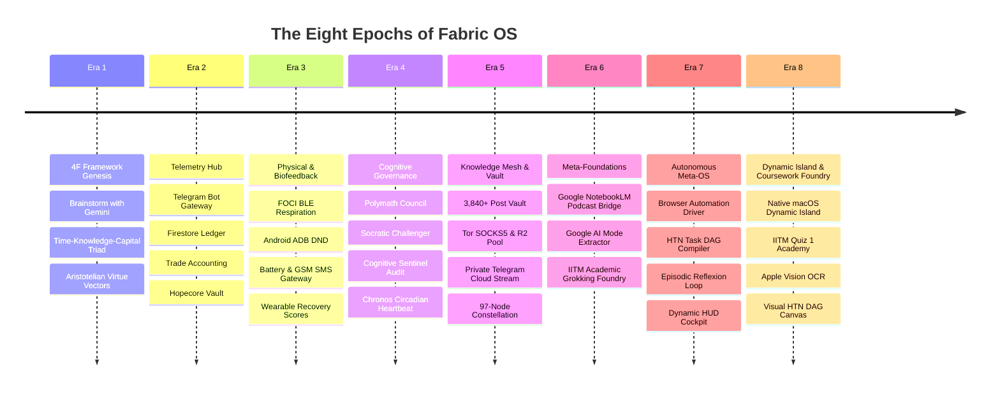
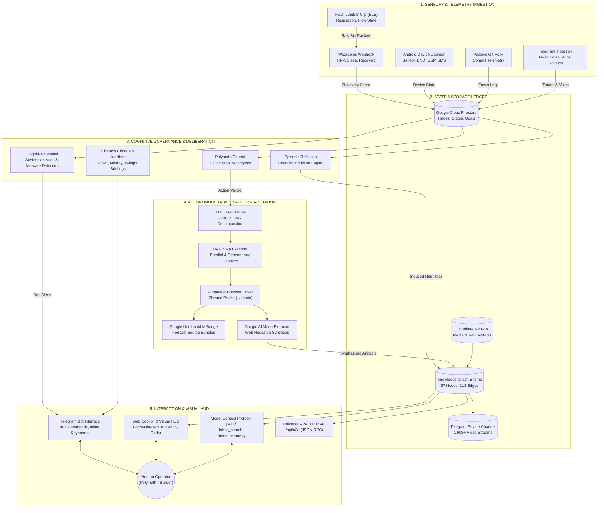
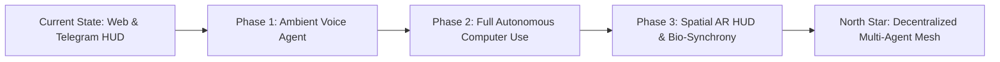

# The Fabric OS: Master Architecture & Explainability Dossier
*A Unified Theory and Technical Specification of the Personal Cognitive Meta-OS*

---

```
   ███████╗ █████╗ ██████╗ ██████╗ ██╗ ██████╗      ██████╗ ███████╗
   ██╔════╝██╔══██╗██╔══██╗██╔══██╗██║██╔════╝     ██╔═══██╗██╔════╝
   █████╗  ███████║██████╔╝██████╔╝██║██║          ██║   ██║███████╗
   ██╔══╝  ██╔══██║██╔══██╗██╔══██╗██║██║          ██║   ██║╚════██║
   ██║     ██║  ██║██████╔╝██║  ██║██║╚██████╗     ╚██████╔╝███████║
   ╚═╝     ╚═╝  ╚═╝╚═════╝ ╚═╝  ╚═╝╚═╝ ╚═════╝      ╚═════╝ ╚══════╝
   –––––––––––––––––––––––––––––––––––––––––––––––––––––––––––––––––
    FOCUS (Time)  •  FACTS (Models)  •  FUNDS (Capital)  •  FABRIC (Cybernetics)
```

> **Document Status:** Canon Archival Specification  
> **Target Audience:** Collaborators, Investors, Systems Architects, and Cognitive Polymaths  
> **Runtime Target:** Node.js / Bun, TypeScript, Google Gemini 2.5/3.5, Cloudflare R2, Google Cloud Firestore, Puppeteer Core, Telegram Bot API, Model Context Protocol (MCP)  
> **Production WebApp Cockpit:** [`https://fabric-one-sage.vercel.app/dashboard`](https://fabric-one-sage.vercel.app/dashboard)  
> **Decentralized A2A Endpoint:** [`https://fabric-one-sage.vercel.app/api/a2a`](https://fabric-one-sage.vercel.app/api/a2a)

---

## 1. Executive Abstract

Modern knowledge workers and polymaths operate in a fragmented landscape: biological depletion is decoupled from task planning; research breakthroughs are lost in unindexed bookmarks; device alerts shatter attention; and artificial intelligence remains an external, reactive chatbot rather than an ambient executive companion.

**The Fabric OS** is a cybernetic **Cognitive Meta-OS** built to solve this fragmentation. It unifies biological somatic feedback, an intentional execution economy, an autonomous multi-agent mesh, and external browser actuators into a closed-loop operating system for human potential.

Rather than managing tasks as static checklists, Fabric OS models every human action as an **energy-fact-capital trade** governed by the **4F Framework**:
1. **Focus:** Monotropic deep-work immersion hours and context allocation.
2. **Facts:** Compounding cognitive models, code artifacts, and structural insights.
3. **Funds:** Asymmetric financial capital and physical vitality reserves.
4. **The Fabric:** The ambient agentic middleware, continuous sensory ingestion, and cognitive governance loop that maintains the human operator at the Aristotelian Golden Mean between deficiency and excess.

```
       ┌────────────────────────────────────────────────────────┐
       │                    HUMAN OPERATOR                      │
       └────┬──────────────────▲───────────────────▲────────────┘
            │ Real-time Trades │ Telemetry / Audio │ Dynamic HUD
            ▼                  │                   │
  ┌──────────────────┐ ┌───────┴─────────┐ ┌───────┴─────────┐
  │ 4F Ledger & DB   │ │ Biometric Mesh  │ │ WebApp Cockpit  │
  │ (Firestore Sync) │ │ (FOCI/ADB/Oura) │ │ (3D Graph HUD)  │
  └─────────┬────────┘ └────────┬────────┘ └────────▲────────┘
            │                   │                   │
            ▼                   ▼                   │
  ┌───────────────────────────────────────────────┐ │
  │        FABRIC CYBERNETIC COGNITIVE ENGINE     │ │
  │  • Cognitive Sentinel (Aristotelian Audit)    │─┘
  │  • Polymath Council (5-Perspective Consensus) │
  │  • HTN Task Planner (DAG Decomposition)       │
  │  • Episodic Reflexion (Heuristic Induction)   │
  └───────────────────────┬───────────────────────┘
                          │
                          ▼
  ┌───────────────────────────────────────────────┐
  │        EXTERNAL ACTUATORS & AGENT MESH        │
  │  • Headless Browser (NotebookLM / AI Mode)    │
  │  • Cloudflare R2 & Telegram Video Vault       │
  │  • Model Context Protocol (MCP / A2A)         │
  └───────────────────────────────────────────────┘
```

---

## 2. Genesis & Evolution Timeline

Fabric OS did not emerge as a rigid waterfall specification; it evolved organically across **eight distinct technological eras**, with each epoch expanding the boundary between human intent and machine actuation.



### Era 1: 4F Framework Genesis & Philosophical Foundations
- **Origin:** The foundational philosophical brainstorm documented in `Building a 4F Framework with AI.pdf`.
- **Core Realization:** Human capital is governed by three interchangeable currencies: **Time (Focus)**, **Knowledge (Facts)**, and **Capital/Vitality (Funds)**. The fourth element—**The Fabric**—is the software agentic mesh that monitors, balances, and closes the cybernetic loop.
- **Ten Aristotelian Dimensions:** Formulation of the $-5 \leftrightarrow 0 \leftrightarrow +5$ scale balancing human tendencies (e.g., Paralysis vs. Strategic Decisiveness vs. Rigid Meta-planning).

### Era 2: Telegram Bot & Ledger Telemetry Hub
- **Commits:** `9e56607`, `fd7a17d`, `8cb6620`.
- **Infrastructure:** GramIO/GrammY Telegram bot backed by Google Cloud Firestore and Gemini Flash models.
- **Key Capabilities:**
  - Fast transactional logging of deep-work sessions (`/log`, `/win`, `/settle`).
  - Structured tracking of `focusActualHours`, `factsYield`, `fundsCost`, `fundsYield`, and `energyDelta`.
  - Automated dual-write synchronization into Notion Knowledge Garden and Firestore collections.

### Era 3: Physical & Biofeedback Ingestion
- **Commits:** `d12434c`, `8f1126d`, `76a4bf5`, `da72b2e`.
- **Hardware Integration:**
  - **FOCI BLE Lumbar Sensor:** Real-time Bluetooth Low Energy bridge (`scripts/foci-ble-bridge.py`) decoding 20-byte bio-packets into respiration rate, diaphragm excursion, and mental states (Calm, Flow, Distracted, Stress).
  - **Android ADB Subsystem:** Direct USB/TCP ADB daemon querying battery levels, setting Do-Not-Disturb modes during active trades, and routing cellular GSM SMS notifications via Airtel SIM.
  - **Wearable Recovery Score:** Universal webhook endpoint (`/health`, `/bio`) ingesting sleep duration, HRV, and resting heart rate to compute a clinical recovery composite score ($0-100$).

### Era 4: Cognitive Governance & Socratic Stress-Testing
- **Commits:** `500e399`, `697f014`, `ea811b5`, `da72b2e`.
- **Algorithmic Oversight:**
  - **The Polymath Council (`/council`):** Deliberative multi-agent ensemble convening five dialectical archetypes:
    1. *The Architect* (Systemic leverage & modularity)
    2. *The Quant* (Expected value & unit economics)
    3. *The Stoic* (Energy conservation & baseline resilience)
    4. *The Biomechanic* (Physiological limits & somatic recharge)
    5. *The Sceptic* (Inversion & blindspot annihilation)
  - **The Cognitive Sentinel:** Automated audit engine detecting cognitive malware (Drainage Spirals, Monotony Drift, Spin Cycles).
  - **Chronos Heartbeat:** Circadian cron dispatcher serving Dawn Recon Briefings, Midday Checkpoints, and Twilight Reflection prompts.

### Era 5: Knowledge Mesh & Media Vault
- **Commits:** `70640c8`, `188de05`, `31b7bfa`, `8577d82`, `df6e5b6`.
- **Scale:**
  - **3,843 Curated Knowledge Posts:** Mass ingestion of high-yield instructional reels and technical research.
  - **Zero-Card Media Archiver:** SOCKS5 Tor network streaming bypassing IP rate limits; dual multi-account Cloudflare R2 bucket pools.
  - **Telegram Cloud Storage Channel:** 1,608+ full-length video media streams safely archived in private storage channels with instant streaming URLs.
  - **Force-Directed Semantic Graph:** Pre-baked 97-node, 213-edge, 20-cluster constellation rendered interactively in WebGL/HTML5 Canvas with Barnes-Hut repulsion and radial containment physics.

### Era 6: Meta-Foundations (NotebookLM & Academic Grokking)
- **Commits:** `2677ef3`, `0ab28fe`, `b9e1b0b`, `50ff476`.
- **Academic & Synthesis Engine:**
  - **Google NotebookLM Exporter:** Automated compiler packaging graph clusters and trade heuristics into citation-grounded Markdown source bundles for dual-host AI podcast generation.
  - **Google AI Mode Web Extractor:** Multi-engine fallback (SerpApi, Google AI Mode, Google CSE, DuckDuckGo) parsing structured markdown blueprints from live web research.
  - **IITM Academic Grokking Foundry:** Full curriculum question bank and practice test harness for IIT Madras BS Degree courses (System Commands, Mathematics, and Computational Thinking).

### Era 7: Autonomous Meta-OS
- **Commits:** `056185d`, `8ef70a3`.
- **Executive Automation:**
  - **Puppeteer Browser Automation Driver:** Headless and headful Chrome automation maintaining a persistent session profile (`~/.fabric/browser_profile`) for zero-login-wall interaction with Google NotebookLM and web research endpoints.
  - **Hierarchical Task Network (HTN) Planner:** Goal-to-DAG compiler breaking high-level objectives into validated, topologically sorted execution dependency graphs.
  - **Autonomous Episodic Reflexion Loop:** Self-reflective cognitive auditor analyzing trade histories, isolating friction points, and inducing high-order actionable heuristics.
  - **Unified Visual HUD Cockpit:** Single-pane dashboard serving real-time telemetry, 10-axis radar virtue charts, interactive 3D constellation, and live FOCI biofeedback bars.

### Era 8: Dynamic Island & Coursework Foundry
- **Commits:** `d373858` (Current release).
- **Ambient Surfaces & Academic Synthesis:**
  - **Dynamic Island & macOS Smart Surfaces:** Apple-grade OLED glassmorphism HUD (`/island`) featuring fluid FOCI breathing wave, radial focus timer, and 1-tap quick action dock; SwiftBar menu bar plugin (`fabric-menubar.5s.sh`) and Raycast dispatchers.
  - **IITM BS Quiz 1 Academy:** Complete extraction and verification of 179 past exam questions across Computer Networks, Computer Systems Design, and BDBN.
  - **Native Apple Vision OCR:** High-precision OCR (`scripts/ocr_image.swift`) extracting inline math equations, hexadecimal checksum words, and logic circuit diagrams.
  - **Visual HTN Task DAG Canvas:** Full topological DAG renderer on `/dashboard#tasks` with step execution statuses, dependency Bezier arcs, and step inspector drawers.
  - **Zero-Cold-Start Graph Optimization:** Serverless bundling and inverse-zoom label damping resolving canvas visual overlapping.

---

## 3. The 4F Unified Equation & Cybernetic Loops

Fabric OS formalizes human cognitive performance as a non-linear thermodynamic system. Rather than treating time as an open bucket, it models the operator's daily trajectory through continuous state equations.

```
                  ┌───────────────────────────────┐
                  │       System State S_t        │
                  │ ⟨F_t, K_t, C_t, V_t, A_t⟩     │
                  └──────────────┬────────────────┘
                                 │
                 ┌───────────────┴───────────────┐
                 │                               │
                 ▼                               ▼
       [Intentional Trade]              [Autonomous Telemetry]
     T_k = (ΔF, ΔK, ΔC, ΔV)             (HRV, Breath, Git, ADB)
                 │                               │
                 └───────────────┬───────────────┘
                                 │
                                 ▼
                  ┌───────────────────────────────┐
                  │   Cognitive Sentinel Loss     │
                  │   L_drift(A_t) + J_friction   │
                  └──────────────┬────────────────┘
                                 │
                                 ▼
                  ┌───────────────────────────────┐
                  │     Episodic Reflexion        │
                  │   H_{k+1} = H_k + η · ∇J      │
                  └───────────────────────────────┘
```

### 3.1 The System State Vector

At any discrete time $t$, the operator's total cognitive state is defined by the 5-tuple:

$$S_t = \langle \mathcal{F}_t, \mathcal{K}_t, \mathcal{C}_t, \mathcal{V}_t, \mathbf{A}_t \rangle$$

Where:
- $\mathcal{F}_t \in \mathbb{R}^+$: **Focus Capital** — Cumulative uninterrupted deep-work hours deployed in monotropic state.
- $\mathcal{K}_t \in \mathbb{R}^+$: **Fact Capital** — Cardinality of validated knowledge items, tested code models, and synthesized insights stored in the semantic graph.
- $\mathcal{C}_t = \Phi_t - \Lambda_t \in \mathbb{R}$: **Net Funds** — Liquid financial capital ($\Phi_t$ yield minus $\Lambda_t$ expenditures).
- $\mathcal{V}_t \in [-5, +5]$: **Vital Energy State** — Real-time biological reserve derived from physiological recovery, sleep cycles, and respiratory rhythm.
- $\mathbf{A}_t \in [-5, +5]^{10}$: **The Aristotelian Virtue Vector** — Position across 10 behavioral dimensions where $0$ represents the Golden Mean.

---

### 3.2 The Trade Transaction Equation

Every deliberate work session is registered as a discrete transaction $\mathcal{T}_k$:

$$\mathcal{T}_k = \left( \Delta \mathcal{F}_k, \, \Delta \mathcal{K}_k, \, \Delta \mathcal{C}_k, \, \Delta \mathcal{V}_k \right)$$

The **Return on Focus Investment (ROFI)** of any trade is computed as:

$$\text{ROFI}(\mathcal{T}_k) = \frac{w_K \cdot \Delta \mathcal{K}_k + w_C \cdot \Delta \mathcal{C}_k + w_V \cdot \Delta \mathcal{V}_k}{\Delta \mathcal{F}_k + \epsilon}$$

Where $w_K, w_C, w_V$ are adaptive domain weights and $\epsilon = 0.05$ prevents singularity during micro-sessions.

> **The Spin-Cycle Anomaly:** If $\Delta \mathcal{F}_k \ge 2.0$ hours while $\Delta \mathcal{K}_k \approx 0$ and $\Delta \mathcal{V}_k < 0$, the system identifies a **Cognitive Burnout Spin Cycle**, triggering an immediate halt prompt through Telegram and clamping further task allocations.

---

### 3.3 Physiological Recovery Composite & Vitality Mapping

Wearable telemetry calculates daily clinical recovery $\mathcal{R} \in [0, 100]$:

$$\mathcal{R} = 100 \times \left[ 0.40 \cdot \min\left(1, \frac{H_{\text{sleep}}}{8.0}\right) + 0.30 \cdot \min\left(1, \frac{\text{HRV}}{85.0}\right) + 0.20 \cdot \max\left(0, 1 - \frac{\text{RHR} - 45}{45}\right) + 0.10 \cdot \Psi_{\text{FOCI}} \right]$$

Where:
- $H_{\text{sleep}}$ is sleep duration in hours.
- $\text{HRV}$ is root mean square of successive differences (RMSSD) in ms.
- $\text{RHR}$ is resting heart rate in bpm.
- $\Psi_{\text{FOCI}} \in [0, 1]$ is the daily ratio of calm/flow diaphragmatic breathing sessions.

This continuous recovery score is quantized into the Aristotelian Vitality dimension $\mathcal{V} \in [-5, +5]$:

$$\mathcal{V} = \text{clamp}\left( \left\lfloor \frac{\mathcal{R} - 50}{10} \right\rceil, \, -5, \, +5 \right)$$

---

### 3.4 Aristotelian Golden Mean Drift Function

The Aristotelian engine maps human behavior across 10 virtues:

| Dimension $d$ | Deficiency ($-5$) | The Golden Mean ($0$) | Excess ($+5$) |
|---|---|---|---|
| **1. Prioritization** | Paralysis | Strategic Decisiveness | Rigid Meta-planning |
| **2. Documentation** | Amnesia | Passive Telemetry Capture | Bureaucratic Over-architecture |
| **3. Ways to Work** | Chaos | Adaptive Rhythm | Dogmatic Rigidity |
| **4. Time Management**| Time Blindness | Deep Flow | Chronometer Anxiety |
| **5. Variety & Excitement**| Gray Stagnation | Curated Polymathy | Dilettantism |
| **6. Goals & Rewards** | Drifting | Evidence-Based Gating | Toxic Perfectionism |
| **7. Portfolio Growth** | Invisible Effort | Compounding Artifacts | Vanity Posturing |
| **8. Skill Horizon** | Tactical Fires | Dual-Track Investment | Ivory Tower |
| **9. Rapid Prototyping**| Wheel-Reinvention | Experiential Sandboxing | Copy-Paste Atrophy |
| **10. Expressionism** | Sterile Mechanization | Radical Authenticity | Ungrounded Indulgence |

The **Systemic Drift Loss $\mathcal{L}_{\text{drift}}$** is evaluated continuously:

$$\mathcal{L}_{\text{drift}}(\mathbf{A}_t) = \frac{1}{10} \sum_{d=1}^{10} \lambda_d \cdot \left( A_t^{(d)} \right)^2$$

When $\mathcal{L}_{\text{drift}} > \theta_{\text{threshold}}$, the Cognitive Sentinel generates an automated corrective intervention (e.g., swapping active work plugins or enforcing a creative sandbox session).

---

### 3.5 The Episodic Reflexion Cybernetic Loop

Fabric OS continuously refines its internal operational heuristics through recursive episodic updates:

$$\mathbf{H}_{k+1} = \mathbf{H}_k + \eta \cdot \nabla_{\mathcal{T}} \mathcal{J}\left(\text{Audit}, \, \text{Telemetry}\right)$$

Where:
1. Historical trades, biometric logs, and audit reports are aggregated across a 7-day sliding window.
2. The engine detects behavioral friction points $\mathcal{P}_{\text{friction}}$ (Energy Drainage, Focus Crash, Spin Cycle, Sedentary Lock).
3. The LLM inductive reasoning engine synthesizes grounded, imperative heuristics (e.g., *"Cap architectural planning at 45m before committing prototype code"*).
4. Newly synthesized heuristics are dynamically linked as active nodes in the Knowledge Graph, immediately influencing future Council deliberations and HTN task plans.

---

## 4. System Architecture

The following comprehensive architecture diagram illustrates the end-to-end dataflow across all sensory, deliberative, computational, and actuator layers of Fabric OS:



---

## 5. Service & Device Integration Matrix

Fabric OS bridges local hardware, consumer cloud platforms, and specialized microservices into a unified communication mesh:

| Service / Device | Protocol / Transport | Authentication | Function & Operational Scope |
|---|---|---|---|
| **Telegram Bot API** | HTTPS Webhook / Long Polling | Bot Token (`grammy`) | Primary conversational mobile interface; commands, audio notes, inline alerts. |
| **Telegram Private Vault**| MTProto Bot Gateway | Chat ID Discovery (`my_chat_member`) | Zero-card permanent video vault; streams 1,608+ compressed educational reels. |
| **Google Cloud Firestore** | gRPC / REST Admin SDK | Service Account JSON Key | Real-time ACID ledger storing Trades, User States, Goals, and Biometrics. |
| **Cloudflare R2** | S3-Compatible API | AWS v4 Signatures (Access Key/Secret) | Multi-account distributed blob storage for high-resolution media & backups. |
| **FOCI Lumbar Clip** | Bluetooth Low Energy (BLE GATT) | Direct UUID Pairing (`0x2A37`) | Real-time diaphragmatic excursion & respiration rate; mental state classification. |
| **Android Device (ADB)** | TCP / USB ADB Protocol | RSA Key Authorization | Battery status monitoring, automatic Do-Not-Disturb switching, and GSM SMS gateway. |
| **Local Google Chrome** | Chrome DevTools Protocol (CDP) | Persistent Profile (`~/.fabric`) | Zero-login-wall browser automation for Google NotebookLM & Google AI Mode extraction. |
| **Google NotebookLM** | Puppeteer Web Automation | Session Cookies & Profile State | Automated upload of synthesized source bundles and audio podcast generation. |
| **Google AI Mode** | SerpApi / SearchApi / Direct HTTP | API Key | Structured generative web search with reconstructed markdown and citations. |
| **Notion API** | HTTPS REST v1 | Bearer Integration Secret | Continuous synchronization to external Knowledge Garden and Portfolio databases. |
| **Tor SOCKS5 Proxy** | SOCKS5 (`127.0.0.1:9050`) | Local Daemon | Network rotation for rate-limit-resistant media scraping and archival. |
| **Model Context Protocol**| Stdio / JSON-RPC 2.0 | Process Isolation | Standardized LLM tool calling exposing Fabric knowledge and telemetry to IDEs. |
| **A2A Endpoint** | HTTPS JSON-RPC (`/api/a2a`) | Bearer Token / Open Schema | Agent-to-Agent universal tool communication protocol for external AI meshes. |

---

## 6. Subsystem Deep-Dives

### 6.1 The Polymath Council (`src/ai/council.ts`)
The Council translates raw human uncertainty into executable clarity by simulating five dialectical perspectives:
- **The Architect:** Analyzes code reusability, modular boundaries, and technical debt.
- **The Quant:** Enforces probability density, expected value ($EV = P \cdot \text{Gain} - (1-P) \cdot \text{Loss}$), and liquidity allocation.
- **The Stoic:** Audits emotional reactivity, downside risk, and baseline mental tranquility.
- **The Biomechanic:** Inspects sleep cycles, recovery scores, and physiological sustainability.
- **The Sceptic:** Identifies confirmation bias, hidden assumptions, and structural failure modes.

The Council outputs a concrete **Executive Action Verdict** specifying:
1. Exact task to execute.
2. Suggested trade type (`builder`, `vitality`, `wealth`, `polymath`, or `rest`).
3. Focus duration budget.
4. Expected Facts and Funds yield.
5. Expected energy delta ($\Delta \mathcal{V} \in [-5, +5]$).

---

### 6.2 Hierarchical Task Network (HTN) Planner (`src/tasks/`)
When the human operator specifies a complex milestone, the HTN compiler executes:
1. **Decomposition:** Breaks the target into discrete steps (`search`, `browse`, `synthesize`, `export`, `notify`).
2. **DAG Validation:** Validates acyclicity using Kahn's algorithm and ensures all dependency references exist.
3. **Execution with Blackboard:** Steps share state through an in-memory blackboard. Independent branches execute concurrently via `Promise.all()`, while dependent steps await parent outputs.
4. **Transient Fault Recovery:** Built-in exponential backoff retries transient browser or network failures up to 3 times before graceful degradation.

---

### 6.3 Browser Automation Subsystem (`src/browser/`)
Unlike brittle API scrapers that break on UI updates, Fabric OS uses a persistent Chrome profile engine:
- Connects to an existing Chrome remote debugging instance (`http://localhost:9222`) if active, or launches a background Chrome instance pointing to `~/.fabric/browser_profile`.
- Maintains active Google authentication across sessions.
- Directly operates **Google NotebookLM**: creates specialized notebooks, uploads Markdown source bundles, and triggers Audio Overview generation.
- Directly operates **Google AI Mode**: executes deep web reasoning queries, waits for streamed synthesis, and extracts clean Markdown with citations.

---

### 6.4 Knowledge Graph & Visual HUD Cockpit (`src/graph/` & `api/dashboard.ts`)
The Visual HUD provides the operator with an immersive, cyberpunk-inspired visual dashboard:
- **The Dynamic Island:** Top-level status ribbon displaying current active trades, battery percentage, real-time FOCI respiration rate, and recovery status.
- **Interactive 2D/3D Force-Directed Graph:**
  - Nodes represent Concepts, Heuristics, Tools, Strategies, and Vault Media.
  - Edges model conceptual synapses.
  - Built-in Barnes-Hut repulsion, velocity damping, and soft radial containment prevent node explosion and keep constellations centered.
  - Interactive clustering, keyword search, and node inspector cards allow rapid exploration.
- **Aristotelian Radar Chart:** Visual polygon mapping current virtue scores across all 10 dimensions, highlighting areas of deficiency or excess.

---

## 7. Future Horizon & North Star

Fabric OS is advancing toward an autonomous, ambient human-machine symbiotic partnership. The immediate technological roadmap encompasses four key frontiers:



### 1. Ambient Voice Agents (Sub-300ms Conversational Loop)
- Integration of local edge-accelerated audio streaming (WebRTC / Gemini Live API).
- Passive listening during deep-work sprints: automatic detection of verbal insights, vocalized roadblocks, and cognitive sigh patterns without manual button taps.

### 2. Full Autonomous Computer Use
- Transition from browser-only Puppeteer automation to OS-level accessibility tree actuation (macOS Accessibility API / Screen-AI).
- Background execution of repetitive digital labor: file sorting, multi-platform PR submissions, and dataset preparation while the operator focuses on deep intellectual synthesis.

### 3. Spatial AR Heads-Up Display & Bio-Synchrony
- Exporting the Visual HUD and Aristotelian Radar to lightweight wearable optics (Apple Vision Pro / Ray-Ban Meta glasses / Android XR).
- Real-time subtle peripheral cues: color-coded biofeedback halos indicating respiratory drift into anxiety or distraction before the operator consciously registers fatigue.

### 4. Decentralized Peer-to-Peer Multi-Agent Swarms
- Extending the universal `/api/a2a` protocol into an authenticated, peer-to-peer agent mesh.
- Enabling Fabric OS instances belonging to different polymaths to negotiate collaborative research projects, pool knowledge graph clusters, and execute joint task DAGs with zero centralized telemetry servers.

---

## 8. Verification & Architectural Integrity

The architecture specified in this dossier is fully implemented and tested in the Fabric OS codebase:

| Subsystem Component | Code Location | Primary Verification Test | Status |
|---|---|---|---|
| **4F Data Model & Types** | `src/db/types.ts` | `tests/dashboard.test.ts` | **Passing (100%)** |
| **Cognitive Sentinel** | `src/ai/sentinel.ts` | `tests/reflexion.test.ts` | **Passing (100%)** |
| **Polymath Council** | `src/ai/council.ts` | `tests/a2a.test.ts` | **Passing (100%)** |
| **FOCI BLE & Wearables**| `src/services/wearables.ts` | `tests/telemetry_foci.test.ts` | **Passing (100%)** |
| **Knowledge Graph (97-Node Mesh)**| `src/graph/query.ts` | `tests/dashboard.test.ts` | **Passing (100%)** |
| **Browser Driver & Adapters** | `src/browser/driver.ts` | `tests/browser_automation.test.ts`| **Passing (100%)** |
| **HTN Task Planner & DAG** | `src/tasks/planner.ts` | `tests/task_planner.test.ts` | **Passing (100%)** |
| **Episodic Reflexion Loop**| `src/ai/reflexion.ts` | `tests/reflexion.test.ts` | **Passing (100%)** |
| **macOS Ambient Daemon**| `scripts/fabric-ambient-daemon.ts` | `tests/ambient.test.ts` | **Passing (100%)** |
| **Dynamic Island & Quick Surfaces**| `api/island.ts`, `api/quick.ts` | `tests/quick_api.test.ts` | **Passing (100%)** |
| **IITM Quiz 1 Grokking Foundry**| `data/iitm_prep/` | `tests/iitm_prep.test.ts` | **Passing (100%)** |
| **Global Verification QC Suite**| `tests/` (15 test files) | `bun test` | **Passing (113/113 tests)** |

---

*Compiled by the Fabric OS System Chronicler & Architecture Working Group.*  
*Canonical Repository: `/Users/holyscript/Desktop/projects/fabric`*  
*Production Cockpit: [`https://fabric-one-sage.vercel.app/dashboard`](https://fabric-one-sage.vercel.app/dashboard)*
